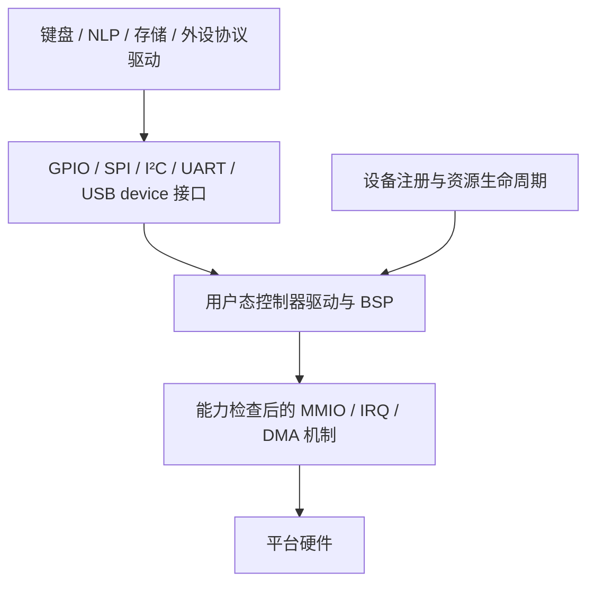

# 用户态设备驱动模型

<!-- Copyright (C) 2026 NOS contributors -->

公共接口位于 `include/nos/driver/`，实现位于 `servers/drivers/framework/`；SPI NOR 协议位于 `servers/drivers/spi/nor.c`。这些是用户态 C 接口，不改变 syscall ABI，也不把文件系统、USB 类协议或设备枚举业务放进内核。

本轮提供静态设备注册、显式 compatible 匹配与 probe/remove、父设备依赖、资源 lease 回滚、挂起/恢复，以及 GPIO、SPI、I²C、UART、USB device 数据通路。NK60 的 GPIO 扫描、SPI1/W25Q 和 USB IN 发送已实际接入。I²C 控制器接口有独立模型验证；尚未为 NK60 启用新的 I²C 引脚/控制器。原 VFS 的 virtio 和中断串口继续使用已有实现。



## 设备生命周期

调用方分配 `nos_device_registry`、表空间和 `nos_device`，不使用堆、全局单例或链接器自动注册。设备名字在 registry 内唯一；`compatible` 精确匹配 `nos_driver`。父设备必须先注册；绑定子设备前父设备必须 ACTIVE。设备、字符串、资源表、lease 和控制器对象在使用期间不得移动或按值复制。

1. `nos_device_register()` 检查资源范围、重复资源 ID、父设备及容量；进入 REGISTERED。
2. `nos_device_bind()` 持有父设备引用并执行 probe。成功进入 ACTIVE；失败先调用 remove 清理部分初始化，再倒序释放已取得的资源，进入 FAILED，可再次绑定。
3. 每次统一外设调用持有设备引用和控制器 busy 标志。回调返回后释放；活动 I/O、子设备或显式 `nos_device_get()` 引用阻止 unbind/suspend。
4. `nos_device_suspend()/resume()` 调用配对的电源回调；失败保留原状态。驱动必须撤销自己失败的电源转换。没有回调返回 ENOTSUP。
5. `nos_device_unbind()` 在没有使用者时执行 remove，再倒序释放资源，释放父设备引用。解除挂起设备也会调用 remove。最后按子到父顺序 unregister。

父引用在子设备挂起期间仍保留，保证父控制器一直供电；当前不会自动拓扑排序整棵设备树的电源转换。remove 必须先停止硬件请求、IRQ/DMA，能够处理 probe 的任意部分失败，且不能失败。描述符必须从注册到注销保持不变。

registry/lifecycle/I/O 由所属服务的同一事件循环串行管理。`busy` 检测回调重入，**不是线程锁**；多线程服务必须在外层使用已有 NOS mutex 或 IPC 串行化。回调不得重入设备生命周期。没有跨服务裸指针共享或自动 `/dev` 发布；跨进程客户端继续经过服务 IPC。

## 资源与权限

资源类型为 MMIO、IRQ、DMA、CLOCK、RESET、PINCTRL，采用 64 位总线地址与大小、32 位 provider ID；MCU 不因使用描述符而需要 MMU。每设备最多 16 个资源/lease，容量溢出明确报错。

`nos_device_acquire_resource()` 从已声明的资源中选择 type/id，再调用 BSP 的 `nos_resource_provider.acquire`。provider 成功返回不透明 token；框架用调用方提供的 `nos_resource_lease` 记录所有权，禁止同一设备重复取得同一资源，失败 probe/unbind 自动逆序 release。provider 自行回滚它失败的 acquire。release 不得再向设备添加资源。

资源描述符是声明，**不是授权**。provider 必须通过现有能力机制取得 MMIO 映射、IRQ 对象和 DMA buffer；框架不根据 start 自动强转为指针，也不接受客户端传来的物理地址。CLOCK/RESET/PINCTRL provider 同样负责平台顺序、共享引用和失败恢复。通用框架不虚构一个尚不存在的内核通用时钟或 IOMMU syscall。

当前 NK60 使用已有的严格 MMIO 白名单和 RGB 固定 DMA syscall；GPIO/SPI probe 管理板级共享门控和引脚，未通过描述符扩大寄存器权限。GPIO 是 SPI CS/引脚的父依赖，USB 独立。静态 NK60 枚举表在初始化后可释放，其设备对象继续由 service 持有；通用动态查找场景必须保留 registry。

## 外设契约

| 接口 | 公共行为 | BSP/控制器责任 |
|---|---|---|
| GPIO | controller-local pin、输入/输出、pull、open drain、active-low、初始输出电平 | 先设置输出锁存值再启用输出；能力不支持返回 ENOTSUP；pinmux 属于平台 |
| SPI | 8 位、mode 0–3、频率上限、CS、多 segment、一笔事务总 deadline、TX fill、可丢弃 RX | 一次选中 CS 完成全部 segment；错误也释放 CS 并停止 DMA/移位；不可隐式拆成多笔 |
| I²C | 7/10 位地址能力、message 数组、每段方向、repeated START、末尾 STOP、显式 recover | 全事务成功或负 errno；错误发 STOP/清总线，不自动重试可能已经写入的事务 |
| UART | 格式配置、poll、非阻塞 read/write、短 I/O、无进展 EAGAIN | 控制器保持格式；不支持参数明确拒绝；正数仅用于真实完成字节数 |
| USB device | enabled-IN mask、max packet、send/cancel/halt、ZLP 与 EAGAIN | send 返回前复制/消费数据，完成事件另行交付；cancel 清除旧完成状态；类协议维护枚举/控制状态 |

SPI/I²C 一次最多 16 段，总字节最多 65536，且受具体控制器 `max_transfer` 进一步限制；零长度段被拒绝。超时必须为 1..INT32_MAX 微秒，避免回绕比较歧义。同步 callback 返回之前完成/终止所有 DMA，不得保留调用方 buffer；不能提供这种语义的异步控制器应先实现同步适配，不能提前返回成功。

I²C address NACK 返回 ENODEV，data NACK/仲裁/短传输返回 EIO，超时 ETIMEDOUT。框架保留控制器负错误，意外的正 status 转 EIO。SPI 回调自行以单个整笔 deadline 约束所有等待；框架无法中断一个不遵守契约的后端。NK60 后端同时使用时间上限和轮询次数上限，时钟停止也有限退出。

USB v1 范围是 **device 数据通路**。EP0 请求、端点配置/分配、SET_ADDRESS 的 status-stage 时序、SETUP/reset/suspend/remote wake、复合功能组合和 OUT 数据事件仍沿用 `servers/usb/keyboard_usb.h` 的类/平台边界；没有实现 USB host、hub、xHCI、通用 class 注册总线或异步 URB API。NK60 HID/NLP 描述符和背压队列保持原契约。`in_mask` 限制控制器允许的 IN 地址，枚举/暂停/endpoint halt 的动态状态仍由后端检查。

## 可复用协议和后端

`nos_spi_nor` 不包含 MCU 寄存器。设备只提供 SPI target、time/delay/progress，便可复用 W25Q JEDEC 检测、24 位地址、1–16 MiB、跨 256 字节页编程、4 KiB 擦除、WEL/BUSY 检查和写后/擦后读回验证。每笔 SPI 超时 20 ms；芯片 program/busy 等待 1 s，erase 等待 3 s；时钟停滞仍有 100000 次轮询上限。读按 64 字节分块，在 CS 释放后调用 progress，保留 NK60 USB/扫描推进能力。progress 不得重入同一 NOR；同一芯片的高层读/改/写也必须由服务串行化。

这是 W25Q 三字节命令子集，没有宣称通用 SFDP/QSPI/四字节地址支持。NK60 SPI1 后端在 APB2=84 MHz 前提下选择不超过请求频率的分频，最高 21 MHz，仅一个板载 CS、MSB-first；不支持的低频/LSB 设置明确返回 ENOTSUP。SPI2 RGB 的专用 DMA/波形通路继续由板级处理。

`nos_uart_16550` 是实际可复用的轮询寄存器驱动，通过逻辑 register index 的读写回调适配不同 stride/宽度/屏障。支持 5–8 数据位、none/odd/even parity、1/2 stop（5 位+2 stop 明确拒绝）、baud divisor 与 3% 误差上限；非空 RX 或未完成 TX 时拒绝重配。没有 IRQ/FIFO/RTSCTS 支持。它不是完整的 Rockchip DW APB UART 驱动，也没有自动替换当前 VFS 串口。

以下是外设驱动读取 I²C 寄存器的典型形态；总线控制器可来自任何平台，外设代码不需要修改：

```c
uint8_t reg = 0x10, data[2];
struct nos_i2c_message messages[] = {
    {&reg, 1, 0x50, 0},
    {data, sizeof(data), 0x50, NOS_I2C_READ},
};
int error = nos_i2c_transfer(bus, messages, 2, 10000);
/* 成功必须经过 repeated START；出现错误不能使用 data。 */
```

## 平台接入顺序

| 平台 | CPU/启动工作 | 驱动框架接入工作 | 当前状态 |
|---|---|---|---|
| ESP32 原版/S3 等 Xtensa 型号 | 新增 Xtensa 异常、上下文、中断、原子操作、启动和内存布局；现有 RISC-V 端口不能替代 | pin matrix/clock/reset provider、GPIO、UART、SPI、I²C；USB 按具体芯片能力；Wi-Fi/BT 另行适配 | 设计入口，未提供平台固件 |
| ESP32 C 系列等 RISC-V 型号 | 按确切型号核对 ISA/特权模式/中断控制器、启动 ROM、RAM/Flash/cache、SMP 与保护能力 | 同上；区分仅 USB Serial/JTAG 与可编程 USB OTG，不能统一当作 gadget 控制器 | 设计入口，未提供平台固件 |
| RK3588 | AArch64 启动链、内存图、GIC、定时器、SMP；现有 arm64_virt 仅作架构基线 | CRU/GRF/pinctrl、DW UART、GPIO/I²C/SPI；随后 PHY/USB host-device 和 DMA/cache；按外设补 IOMMU | 设计入口，未提供板级启动 |

建议先做每平台串口/计时/异常与 GPIO，再 SPI NOR 和 I²C 屏幕/旋钮，最后 USB、网络和 DMA；先用静态设备表明确板级连线。DTS/FDT 枚举器以后可生成同一 `nos_device`/resource 描述符，不需要让外设协议驱动解析 DT。没有把 Linux 厂商驱动直接塞进内核，亦没有预置未经板型确认的地址或 IRQ。

## 验证

```sh
source /workspace/.nos-env/activate.sh
python3 tests/host_driver_framework.py
python3 tests/acceptance.py --section boards --section baseline --require-frozen-source
```

新增框架测试运行实际 C 实现，在 ASan/UBSan/LSan 下覆盖父依赖、probe 失败、资源倒序回收、PM 失败、重入/使用中卸载、GPIO 极性、SPI 多段边界、I²C repeated-START 消息接口、UART 短 I/O、16550 寄存器驱动、USB 背压，以及不含 NK60 头文件的独立 SPI NOR 控制器模型。模型不能证明 I²C 实际电气时序。现有板级测试验证 NK60 SPI 超时/CS 清理、Flash 分页/保护、矩阵和 RGB、USB/NLP/灯效；两种 MPU 固件检查 SRAM/Flash 边界。

QEMU 来宾另执行实际框架的资源回滚、64 位资源 token、GPIO 极性和使用中拒绝卸载测试（`driver_framework_userspace_lifecycle`）。原版 QEMU 的三种 MMU 架构与 STM32 基线证明原有功能兼容；不会由此推断 ESP32/RK3588 硬件支持。NK60 的 Cortex-M 入口专项仍显式跳过 F401 时钟初始化，实板时钟、电气、USB 枚举及扫描/灯效延迟待真实硬件验证。
