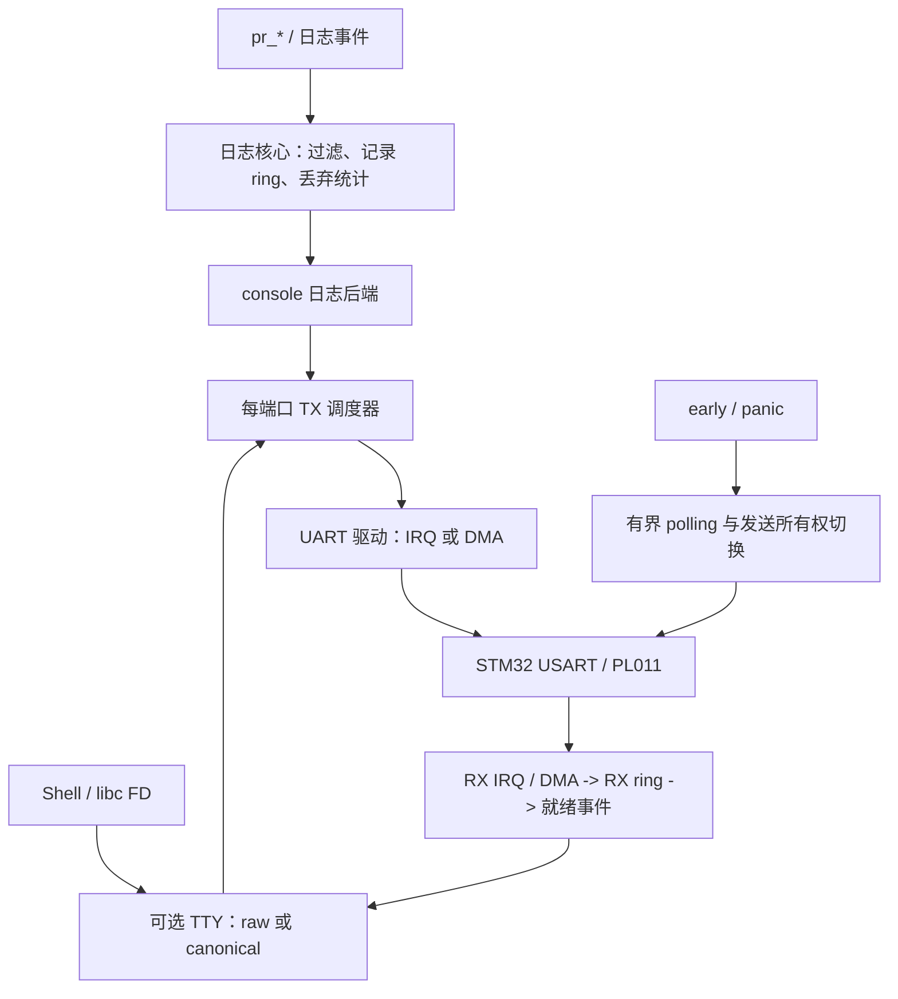

# NOS 日志、UART 与 TTY 设计审查

> 本文记录实施前的审查。当前实现、验证结果与剩余事项见 [落地说明](LOG_UART_TTY_IMPLEMENTATION.md)。

日期：2026-10-27。源码基线：`c03dad5`。

本文是源码审查与优化建议，未修改运行时代码。最低目标由用户确认为 **20 KiB RAM 也要可用**；同时覆盖 64/128 KiB STM32 和带 MMU 的 ARM64。文中的建议缓冲区大小是待实现、待测量的预算，不代表当前已经达到。

## 1. 结论

优先顺序是：修复正确性与内存浪费，统一 UART 的收发所有权，再补可裁剪的 TTY 和大设备日志留存。

当前主要限制不只是缓冲区大小：日志格式化不安全，日志传输与全局 UART DMA 开关耦合，板级 console 同时承担驱动、接收通知和行编辑。`tty0` 目前是 console 注册名，尚无独立 TTY 子系统。

建议采用同一套分层接口，通过资源配置选择最小终端或完整终端。20 KiB 目标默认使用静态小缓冲、IRQ 收发、无独立日志任务、无完整 Shell；大设备增加日志留存、多后端、TTY/POSIX 功能。ARM64 的启动、标准库和 PL011 接入还需要单独补齐。

## 2. 当前调用链

```text
pr_info/pr_err/vprintk
    -> 全局 4096 B 格式缓冲
    -> kernel_log_write
         UART_DMA=n -> console_write -> 板级逐字节 polling
         UART_DMA=y -> 全局字节 FIFO -> 板级 send_log -> DMA 临时缓冲

Shell / libc stdout、stderr
    -> console_write / console_putc -> 直接 polling，绕过日志 FIFO

UART RX
    NK60       -> IRQ -> FIFO -> 8 位计数信号量 -> console_getc
    QEMU STM32 -> console_getc 内忙轮询
    ZJ / WL    -> IRQ 内行编辑与同步回显
```

QEMU STM32 已经通过 `drivers/serial/uart_stm32.c` 的 `UART1` device 接入 console；其他 STM32 板仍使用旧板级 `uart_config/usart_send` 路径。新 UART device 又在所有 STM32 构建中初始化同一 USART1，存在双重配置与所有权问题。

## 3. 需要优先修复的问题

### 3.1 高：格式缓冲越界与重入污染

位置：`kernel/printk/printk.c:21,69,86`；`app/shell/nshell.c:70,75`。

`pr_log` 和 `vprintk` 共用无锁的静态 4096 B 缓冲，调用无长度限制的 `vsprintf`。线程被另一线程或中断打断时，缓冲可被覆盖；超过容量的日志直接破坏相邻内存。Shell 的栈上 1024 B 格式缓冲也存在无边界写入。

直接编译真实 `printk.c` 与 `libs/vsprintf.c` 的主机探针复现了：

- 5999 字节字符串触发 ASan `global-buffer-overflow`，写出 4096 B `log_buf`。
- 在日志消费入口模拟嵌套打印，外层 `OUTER123` 变成字节序列 `INNER\0 23`。

建议使用每次调用独立的有界格式空间，在短临界区内提交完整记录。不能简单地给共享缓冲加锁后持锁输出整条串口日志，也不能把缓冲直接缩小后继续用 `vsprintf`。

中断优先使用只含有限整数参数的事件接口，限制字符串扫描和字段宽度。普通 `vsnprintf` 即使限制写入长度，也未必限制格式化执行时间。

### 3.2 高：现有格式化器不适合 64 位平台，零容量边界也有错误

位置：`libs/vsprintf.c:50,214,229,279,341,399`。

整数中间值为 `uint32_t`，`print_number` 接受 `int`；`%p` 最终也进入该函数。`l` 分支按 `uint32_t` 取参，缺少 `ll`、`z` 等常用长度修饰符支持。

真实格式化器的主机探针结果：

| 输入 | 实际输出 | 问题 |
| --- | --- | --- |
| `%p`，值 `0x1234567887654321` | `0000000087654321` | 高 32 位丢失 |
| `%lu`，同一数值 | `2271560481` | 截断为低 32 位 |
| `%llu` | `%lu` | 未处理双 `l` |
| `snprintf(dst, 0, "hello")` | 仍写入 `hello` | 零容量写入越界 |

这些测试是在 64 位 ARM 主机上执行，不等同于 ARM64 固件运行验证。源码中的取参类型与转换已经足以确认可移植性问题。

应先明确日志格式支持契约，修复或替换格式化器，覆盖 `%p/%ld/%lu/%lld/%llu/%zu` 以及容量 0、1、截断返回值和负数边界。STM32 可以关闭浮点格式，64 位整数和指针正确性必须保留。`vsnprintf` 返回“本来需要的长度”时，交给输出端的长度仍必须截断到实际写入量。

### 3.3 高：日志 FIFO 多分配了指针宽度倍的内存

位置：`kernel/printk/log.c:19,26`。

当前声明是 `char *log_buf[CONFIG_LOG_FIFO_BUF_SIZE]`，而 FIFO 按字节初始化。数组分配的是 N 个指针，实际只使用 N 字节。以下值已经用本轮重新构建的 ELF / map 核对：

| 板型 | 链接脚本 RAM | 配置的 FIFO | 实际 FIFO 数组 | 格式缓冲 | 两块日志缓冲合计 |
| --- | ---: | ---: | ---: | ---: | ---: |
| WL-001 | 20 KiB | 512 B | 2048 B | 4096 B | **6144 B，RAM 的 30%** |
| NK60-V2 | 64 KiB | 512 B | 2048 B | 4096 B | 6144 B |
| QEMU STM32 | 128 KiB | 512 B | 2048 B | 4096 B | 6144 B |
| ZJ-V3 | 64 KiB | 4096 B | 16384 B | 4096 B | **20480 B，RAM 的 31.25%** |

表中不含 FIFO 元数据、接收缓冲、DMA 缓冲、任务栈等。四个板当前都关闭 UART DMA，但 `kernel_log_init()` 仍初始化 FIFO，因此这些数组仍出现在 ELF 中。

改成字节数组这一项就可分别节省 1536 B 或 12288 B。若选择无队列的同步最小模式，应编译掉对应 FIFO 及初始化；异步模式则保留按预算分配的字节/记录缓冲。

如果原声明移植到 64 位平台，N 字节配置会分配 8N 字节；这是类型推导，未获得 ARM64 固件 ELF 验证。

### 3.4 高：日志级别配置与代码语义不一致

位置：`include/kernel/printk.h:16`、`kernel/printk/printk.c:37`、`Kconfig:264`、`configs/fragments/debug.conf:3`。

代码枚举按 `ALL=0, DEBUG=1, INFO=2, WARNING=3, ERROR=4, FATAL=5, DISABLE=6` 排列，却使用严格的 `level > g_log_level`。因此设为 ERROR 只剩 FATAL，设为 FATAL 则没有日志。Kconfig 又把 0..7 描述为 syslog 等级，调试片段设为 7 后全部屏蔽。

主机探针依次设置阈值 0..7，五个真实日志等级的输出条数为：`5,4,3,2,1,0,0,0`。

建议保留现有五个严重性名称，统一为“最低输出严重性”，使用包含阈值的判断；同步修改 Kconfig 范围、说明、默认值和调试片段。另加编译期等级过滤，移除不需要的格式字符串、调用与参数求值。panic 走独立紧急路径，不受普通日志开关影响。

### 3.5 高：RX 的计数通知会溢出，也存在丢失唤醒窗口

位置：`board/nk60-v2/arch_console.c:61`、`include/kernel/sem.h:17`、`kernel/ipc/sem.c:54,120`。

NK60 接收 FIFO 为 512 B，`sem_t.count` 却是 `uint8_t`。没有读者及时消耗时，256 次接收会让计数回卷；FIFO 满时仍无条件发送通知，又会产生“有通知但无字节”。`sem_get` 的计数检查和等待队列插入之间也没有统一的锁来防止 IRQ 到达造成丢失唤醒。

这是源码与类型分析，尚未在真实 NK60 上执行突发输入复现。

建议以 RX ring 的非空状态作为读取依据，用可合并的“RX 就绪”事件通知读者；消费者醒来后批量排空。检查空状态、准备等待和发布数据必须遵守同一套原子协议。仅把计数改成 16 位不能解决其余问题。

现有 `include/nos/ipc.h` 中的 notification 位图可作为复用候选，仍需验证 IRQ 唤醒、锁顺序及 SMP 行为。ISR 只搬运字节、记录错误和通知，行编辑与回显放在线程上下文。

### 3.6 高：DMA 状态机与正常输出缺少统一所有者

位置：`board/nk60-v2/arch_console.c:43,72`，ZJ/WL 有类似实现。

`dma_transport` 的检查、FIFO 取数、设置 busy 和启动 DMA 不在同一受保护的状态转换中，DMA 临时缓冲也没有完整的所有权协议。线程切换或更高优先级中断日志可能在启动窗口内再次进入。Shell、libc 输出又直接 polling 写同一个 USART DR，可以与日志 DMA 并发，破坏输出顺序。

建议所有正常发送经过每端口唯一 TX 队列/调度器；日志提交整条记录，TTY 提交字节块。DMA 是 UART 驱动内部的一种发送引擎，完成中断统一回收缓冲并推进下一段。polling 仅通过明确的 early/panic 模式切换取得发送所有权。

当前是静态竞态分析，未声称已经在硬件上复现 DMA 数据损坏。

### 3.7 高：panic 与 UART DMA 开关存在功能性陷阱

位置：`kernel/panic.c:21`、`kernel/printk/log.c:36`、`board/qemu-stm32/arch_console.c:57`。

- panic 先关闭 IRQ，再调用普通日志；DMA 首段可能发送，但依赖完成中断继续排空的后续日志无法推进。
- QEMU STM32 的 `send_log` 为空，开启全局 UART DMA 后日志会进入没有消费者的 FIFO。
- FIFO 满时按剩余字节接受半条日志，没有记录边界和丢弃计数。

日志工作模式应与 UART 传输引擎分开配置。没有可用后端能力时应在配置/构建期拒绝该组合。panic 路径使用不依赖调度器和 IRQ 的有界 polling，允许设备故障时超时退出，并避免重新获取可能已损坏或由当前上下文持有的普通锁。

### 3.8 中高：TTY 语义、错误码与字节流尚不完整

位置：`kernel/console.c:111,120`、ZJ/WL `arch_console.c`、`libc/port/picolibc_newlib.c:235,279`、`board/nk60-v2/arch_uart.c:21`。

- ZJ/WL 没有注册 `getc/putc`，console 调用端不检查回调。它们默认未启用新 Shell，但启用后或调用 libc stdin 时可能空指针调用。
- `console_getc` 返回 `char`，无法同时表达任意字节、暂无数据、错误和 EOF；libc 将 NUL 当成 EOF。
- 同步 `kernel_log_write` 丢弃 `console_write` 返回值并返回 0。
- libc stdout/stderr 无论实际输出成功、失败还是短写，都报告全部成功。
- 旧 `usart_send` 见到 NUL 提前停止，不符合带长度的字节流写语义。
- VFS `file_operations` 当前没有 `ioctl/poll`，尚不能承接完整 POSIX TTY。

底层使用返回字节数或负 errno 的批量读写；单字节输入可返回 `int` 的 0..255 或负错误码。EOF 只由有相应语义的端点/挂断条件产生。正常非阻塞读无数据返回 `-EAGAIN`，libc 边界再转换成 `-1/errno`。

### 3.9 中高：同步轮询影响实时性，Shell 栈固定偏大

位置：`drivers/serial/uart_stm32.c:30`、`board/qemu-stm32/arch_console.c:47`、`app/shell/nshell.c:750`。

STM32 TX 每字节等待 TC，无超时。QEMU console 输入忙轮询，等待输入时线程不阻塞，会持续占用 CPU，并影响低优先级任务运行。ZJ/WL 在 IRQ 内执行同步回显，扩大中断耗时。

在 **115200 baud、8N1 的真实线路**上，理论上限为约 11520 B/s，128 B 约 11.1 ms，512 B 约 44.4 ms，4096 B 约 355.6 ms。这里是线路时间估算，QEMU 不一定按真实线路速率节流。

正常输出宜使用 TXE/FIFO/IRQ 或 DMA，TC 留给最终 drain。增加日志缓冲只能吸收突发，不能改变线路吞吐；还需要编译期过滤、限流和丢弃统计。

当前 Shell 固定申请 8192 B 栈，内部格式化另用 1024 B 栈缓冲。20 KiB 配置应默认关闭完整 Shell，按需提供小监控终端；较大配置开放 Shell 栈参数，依据栈高水位测量缩减。

### 3.10 大平台前置项：ARM64 console 和 SMP 基础仍未闭环

位置：`arch/arm64/hal/hal_arm64.c:17`、`arch/arm64/CMakeLists.txt`、`board/CMakeLists.txt`、`include/kernel/spinlock.h:54`。

当前 ARM64 HAL 定义了 PL011 基址，但没有接入 UART 驱动或 console；qemu-virt 板源码未纳入现有板级 CMake 分支，也没有对应固件链接脚本。配置里选择 musl，当前 libc CMake 仍无条件编入 Newlib/Picolibc 端口。

现有 spinlock 把 IRQ 保存值写进共享锁对象，而且在获得锁之前写入。多核等待者可以覆盖持有者的 IRQ 状态。ARM 的锁等待诊断又调用 `pr_err`，如果日志也依赖同一锁，会引入递归。ARM64 `hal_cpu_id` 和上下文切换等仍是初期实现。

在启用 SMP 日志前，先建立调用者保存 flags 的 `irqsave/irqrestore` 契约，清除锁原语对普通日志的依赖，并验证真实 CPU ID、原子操作和唤醒机制。只扩大缓冲或改成每 CPU 缓冲并不能消除这些前置风险。

## 4. 推荐的分层设计



### 4.1 日志核心

先实现“调用现场有界格式化，稍后发送”，保留现有 `pr_*` 调用方式。日志 ring 保存带长度、等级、时间戳等元数据的完整记录，字节容量包含记录头、对齐和回绕开销。小配置记录头可从 8 B 起步；元数据按私有内核实现裁剪，不改变固定 UAPI 结构大小。

最小配置默认整条丢弃新日志，并记录 dropped/truncated/high-water；大配置可选择覆盖最旧完整记录并通过序号报告缺口。队列临界区只负责预留/复制/提交，串口发送和格式化不持 ring 锁。

第一版使用可审计的短临界区多生产者队列即可。每 CPU 缓冲需等 SMP 基础可靠、实测出现锁争用后再引入；每 CPU 空间本身也不能防止同核嵌套中断覆盖。

20 KiB 配置不增加独立日志线程：TX IRQ 推进发送，或由已有工作线程在明确的时间预算内处理日志。后台处理不能依赖 idle 一定运行。较大配置可增加独立低优先级日志工作线程。

只有在字符串、参数生命周期和格式类型打包已有明确契约后，才引入“延迟格式化”。不能保存 `va_list`、调用者栈指针或临时 `%s` 指针供稍后访问。字典/二进制日志可以作为后续 MCU 带宽优化项，同时需要绑定固件构建版本的离线解析工具。

这部分职责划分参考 [Zephyr Logging](https://docs.zephyrproject.org/latest/services/logging/index.html) 的前端、核心、后端、最小模式和 panic 处理；上述大小与迁移取舍是针对 NOS 的建议。

### 4.2 UART 驱动与发送调度

沿用现有 device 和 `uart_driver_api` 扩展能力，逐步把四块板的寄存器逻辑收进共享 STM32 驱动。板级保留实例、引脚、时钟、波特率和 DMA 资源配置；ARM64 增加 PL011 实现。

底层能力覆盖 polling、批量 RX、IRQ TX、可选 DMA、drain 和错误统计。每个端口只有一个正常 TX 引擎，生产者通过队列共享串口；独占二进制协议可以选择专用端口或显式关闭 console/TTY 绑定。

普通写入复制后返回已接受的字节数；若提供零拷贝异步提交，必须明确由谁保持缓冲有效，以及完成/取消/错误时如何归还。DMA 完成前不得复用缓冲。小配置先使用小型 staging buffer；更大配置再考虑直接发送 ring 的连续区段，并在完成时释放已提交区段。

同端口的 TX IRQ 和 TX DMA 必须互斥地管理状态。参考 [Zephyr UART](https://docs.zephyrproject.org/latest/hardware/peripherals/uart.html) 的按需裁剪与 IRQ/异步 API 所有权约束；RX 和 TX 可以在驱动明确支持时选择不同机制。

带缓存/MMU 的设备若启用 DMA，还需要单独处理 DMA 地址、缓冲可达性、缓存维护与内存屏障，不能照搬 STM32 的指针强转；参考 [Linux DMA 指南](https://docs.kernel.org/core-api/dma-api-howto.html)。PL011 使用 FIFO+IRQ 即可作为第一步，DMA 并非 ARM64 必选项。

### 4.3 Console 与 TTY

console 负责选择日志输出设备、早期输出和 panic 后端；TTY 负责交互字节流和终端语义，两者共享 UART TX 调度。

建议按以下层次裁剪：

| 层次 | 功能 | 适用范围 |
| --- | --- | --- |
| 最小 raw 终端 | 批量读写、阻塞/非阻塞、超时、可选小监控命令 | 20 KiB MCU |
| 交互 TTY | 可选 canonical、echo、CR/LF 转换、配置参数 | 较大 STM32 |
| POSIX TTY | VFS FD、ioctl/poll、termios、按需信号/PTY | MMU 大设备 |

Shell 自己做行编辑时，TTY 采用 raw 且关闭 echo；选择 canonical 时，行缓冲和回显由 TTY 负责，避免双重编辑。CR/LF 转换只在一个明确层次执行，原始串口通道保持字节不变。

同一终端上的日志和提示符应在整条日志/发送块边界仲裁；完整 Shell 可以在输出日志后重绘当前输入。20 KiB 最小配置可省略重绘功能，并允许交互期间降低 console 日志等级。

后续把 stdin/stdout/stderr 映射到实际 TTY/console FD，修复错误传播与重定向。微内核配置可以让完整 TTY、PTY 和持久化日志在服务中运行；内核保留小日志 ring 与紧急输出，不能让内核日志同步等待可能正在故障的服务。

端口和终端操作的职责参考 [Linux TTY Driver](https://www.kernel.org/doc/html/latest/driver-api/tty/tty_driver.html) 与 [Low Level Serial API](https://docs.kernel.org/driver-api/serial/driver.html)。NOS 最小配置只实现实际所需的子集。

## 5. 内存与配置预算

以下是建议起点。格式临时空间按一个活动调用估算；若放栈上，它属于相应任务/中断栈预算。并发调用数、控制对象、完整任务栈、调度对象、分配粒度和其他子系统需另外核算。

| 项目 | 20 KiB 最小配置 | 64/128 KiB MCU 起点 | ARM64 起点 |
| --- | ---: | ---: | ---: |
| 单条日志格式空间 | 128 B | 256 B | 512–1024 B |
| 日志记录 ring | 512 B | 1024 B | 64–256 KiB |
| UART RX ring / 端口 | 128 B | 256 B | 4 KiB |
| UART TX ring / 端口 | 128 B | 256 B | 8 KiB |
| 可选终端行缓冲 | 64 B | 128 B | 1 KiB |
| DMA staging | 关闭 | 可选 128 B | 按驱动需求配置 |
| 独立日志线程 | 关闭 | 可选，单独核算栈 | 可选开启 |
| 完整 Shell / PTY | 关闭 | Shell 可选 / PTY 关闭 | 按需开启 |

20 KiB 配置上述数据空间合计 **960 B**，控制对象和任务栈另计。64/128 KiB 示例含 128 B DMA staging 时合计 2048 B。这些不是包含整个子系统栈空间的总 RAM 承诺。

20 KiB 配置的完整 Shell 默认关闭，保留 raw 读写或简单监控终端。若需要独立监控任务，必须计入任务控制块、栈和分配器开销，再用高水位实测确定容量，不能沿用固定 8 KiB 栈。

建议新增或整理以下配置维度，具体命名在实施时与现有 Kconfig 对齐：

- 日志：启用开关、同步/缓冲模式、编译等级、运行等级、单条上限、ring 容量、丢弃策略、可选后台线程和栈大小。
- 串口：每实例能力、RX/TX ring、IRQ/DMA 选择、DMA staging、波特率、polling 超时。
- 终端：启用开关、canonical、echo、POSIX 扩展、PTY、Shell 栈与输入行大小。
- 后端：UART console、可选内存留存、文件/网络导出、panic polling。

资源档位应由 RAM 和用途选择，架构仅提供默认值。不能把所有 STM32 固定为同一容量，也不能把 ARM64 等同于无限内存。

现有 Kconfig FIFO 整数范围允许非 2 次幂，但 `kfifo_init` 会拒绝；应使用容量阶数/受约束 choice，或增加配置期验证。大设备容量也需要解除当前 4096 B 上限。日志 ring 与 UART TX ring 可以先独立保留，便于背压与后端扩展；若内存实测要求继续压缩，再设计明确所有权的共享区段接口。

## 6. 方案比较与实施顺序

| 方案 | 收益 | 代价与局限 | 建议 |
| --- | --- | --- | --- |
| 修补现有板级 console | 可快速消除越界和内存浪费 | 仍有复制逻辑、DMA 耦合与 TTY 扩展成本 | 作为第一阶段 |
| 统一日志/UART/TTY 接口，按配置裁剪 | 同时覆盖 20 KiB 和大平台，边界可验证 | 需要分阶段迁移板级收发 | **推荐目标** |
| 一次实现完整 POSIX TTY 与日志服务 | 大设备功能齐全 | 20 KiB 负担过大，依赖当前未完成的 MMU/服务基础 | 放到后续大平台阶段 |

1. **正确性与立刻节省 RAM。** 修复 FIFO 元素类型、格式化边界、64 位格式、日志等级与错误返回；校验可选回调；建立有界 panic polling。保留兼容包装，避免一次改动所有日志调用点。
2. **先打通 20 KiB 的统一 UART。** 共享 STM32 驱动接管实例配置和 RX/TX；引入小 ring 与就绪事件；移除 IRQ 行编辑和同端口双重初始化；验证 UART DMA 关闭时也可异步发送。
3. **加入完整记录日志和最小 TTY。** 配置单条上限、整条丢弃统计、短临界区提交、raw 字节流和 console 仲裁；把完整 Shell 改成可选且可配置栈。
4. **大设备扩展。** 补齐 ARM64 工具链/标准库、qemu-virt 构建与链接、PL011、启动/IRQ；修复 SMP 锁基础，再开放大 ring、多后端、日志读取、termios/poll 和可选 TTY 服务。

每阶段应保持现有四块 STM32 板可构建；先完成一块迁移并验证，再按共享驱动逐板切换。

## 7. 本轮验证与后续验收

本轮执行：

- `cmake --preset <board>` 与 `cmake --build --preset <board>`：`qemu-stm32`、`nk60-v2`、`zj-v3`、`wl-001` 全部成功，本轮日志未报告编译警告。现有 C 编译选项并未统一开启 `-Wall`，因此这不等同于严格告警审计。
- 对上述新 ELF 使用 `arm-none-eabi-nm -S --size-sort` 及 map 核对日志数据缓冲大小。
- QEMU `netduinoplus2` 有界运行 5 秒：出现内核欢迎信息、Shell 欢迎信息和 `nos#`，未观察到 panic，随后由验证程序发送 SIGTERM 结束。没有把这项结果视为突发输入、DMA 或交互命令验收。
- 真实 `printk.c`、`libs/vsprintf.c` 主机探针：复现长日志越界、重入污染、等级过滤、64 位格式和零容量写入问题；外部内核依赖使用桩，格式化符号重命名以隔离主机 libc。
- ARM64 配置成功；`cmake --build build/qemu-virt-arm64` 失败，当前 `aarch64-elf-gcc` 环境找不到 `string.h`。此环境问题与源码可见的 PL011/链接接入缺口分开记录，未做 ARM64 运行成功声明。

临时构建日志和探针位于 `/tmp/nos-log-tty-review-20261027/`；审查笔记位于 `.planning/2026-10-27-log-uart-tty-review/`。临时目录会被系统清理，核心结论和测量已记录于本文。

后续验收至少覆盖：

| 范围 | 验收场景 |
| --- | --- |
| 格式与内存 | 超长文本、容量 0/1、截断标志、64 位指针/整数、嵌套日志、栈高水位 |
| 日志 | 每个等级、编译期过滤、整条丢弃、饱和后恢复、早期启动与 panic |
| UART RX | 256/512/1024 B 突发、FIFO 满、NUL、线路错误、无输入时线程阻塞 |
| UART TX | Shell 与日志并发、短写、设备未就绪、DMA 完成/错误/取消、空闲到启动竞态 |
| TTY | raw/canonical、echo 单一所有者、CR/LF、非阻塞与超时、能力关闭后的错误码 |
| 小内存 | WL-001 的 BSS、实际可用堆、全部任务栈和最坏中断栈总预算 |
| 大设备 | PL011 IRQ、标准库/FD、SMP 日志压力、可选 DMA 缓存一致性与用户服务故障 |

DMA 与真实线路压力需要硬件验证；QEMU 启动通过不能替代它们。20 KiB 能否承载具体应用，还取决于 USB、文件系统、堆和任务配置，需在日志/串口预算落地后核算整个固件。
