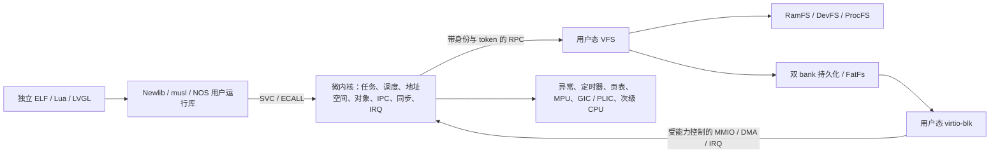

# NOS 微内核架构

<!-- Copyright (C) 2026 NOS contributors -->

默认构建使用跨架构微内核。旧 RTOS 源码、旧板级构建和补丁机型已清理；当前目录见 [SOURCE_LAYOUT.md](SOURCE_LAYOUT.md)。实现与验收的执行清单见 [EXECUTION_PLAN.md](EXECUTION_PLAN.md)，命令见 [QEMU_VALIDATION.md](QEMU_VALIDATION.md)。

真实键盘板目标 `nk60_v2` 使用同一 Cortex-M 微内核，启动用户态键盘服务；扫描、USB HID、改键和 NOR 配置均在服务中，内核仅增加受设备能力检查的寄存器白名单和固定目的 DMA。该目标使用 64 KiB SRAM、128 KiB 擦除对齐应用 Flash、minimal 运行库，不启动通用 VFS。构建、功能与未实测范围见 [NK60 V2](NK60_V2.md)。

## 特权边界

文件业务、节点、文件内容、文件描述符、FatFs 与 virtio 请求队列位于用户态服务中。内核检查用户范围和能力，复制消息并覆盖 sender/process/token 身份。消息有效载荷上限 64 字节，大块 I/O 由用户运行库分块。调试串口输出保留特权传输入口，普通文件与标准 FD 通过 VFS。

设备能力表示受信任的 I/O 域。当前没有 IOMMU；不能把 MMIO/DMA 能力授予任意不可信程序后，仍声称它无法利用设备访问其他物理内存。地址查询只接受本地址空间的有效可写缓冲区；服务退出必须先关闭中断、同步停止 DMA，再释放映射与物理页。

## 内核模块

| 模块 | 实现与契约 |
|---|---|
| `core.c` | 版本化 syscall 分派、用户复制、启动模式、受权执行与服务重启；测试结束入口仅在自测配置启用 |
| `task.c` | 代际 PID、独立进程与共享地址空间线程、wait/退出、孤儿回收、clear_tid、futex、异核取消 |
| `scheduler.c` | 32 个优先级、同优先级轮转、抢占、睡眠、每 CPU current 与固定空闲任务；CPU 0 维护全局 100 Hz 时钟 |
| `mutex.c` | 阻塞互斥锁、能力引用、代际句柄、所有者检查、多锁及传递优先级继承、循环等待检测 |
| `ipc.c` | 多端点授权/撤销、同步 call/recv/reply、IPC 优先级传播、超时/取消、请求 token 与生命周期通知 |
| `irq.c` | 同地址空间授权的 IRQ 对象、绑定、计数、单等待者、超时、屏蔽/确认和退出撤销 |
| `memory.c` | 清零物理页分配、地址空间引用计数、安全用户复制、映射事务回滚、VMA 范围变更、权限与配额 |
| `elf.c` | 有界静态 ELF/PIE 装载、段与入口校验、参数/环境/auxv/TLS、失败清理 |
| `arch/{arm,arm64,riscv,riscv32}/` | 启动/异常上下文、MMU/MPU、UART/GIC/PLIC、缓存和 TLB 同步、SMP 引导 |

内核进入采用粗粒度全局锁，各 CPU 的用户任务能够并发执行。运行中的任务不能同时被另一 CPU 调度；异核取消延迟到目标 CPU 的安全入口处理。当前没有每 CPU 运行队列或负载均衡策略，不宣称具备大型 SMP 系统的扩展性。

RISC-V `virt` 的 IRQ 重新使能保持 hart 0 supervisor context 的阈值不变并写回，确保重新评估屏蔽期间到达的 pending 源。原版 QEMU 10.0.13 的 [PLIC enable 写入实现](https://github.com/qemu/qemu/blob/v10.0.13/hw/intc/sifive_plic.c) 不主动刷新中断线；该处理避免 UART 有数据却无法唤醒接收线程。RV64、RV32 MMU/非 MMU 的受控 pending 窗口回归由实际 NOS ACK 路径完成恢复，测试只读控制器状态。QEMU 保持原版。

## 对象与 ABI

`include/nos/abi.h` 固定 syscall 编号与 ABI 版本；`ABI_QUERY` 返回版本、字宽、消息大小和页大小。消息和指针使用本地字宽，32 位应用不能直接运行在 64 位 ABI 上。

PID、锁、IRQ 和端点带代际信息；对象类型有独立句柄范围，达到代际上限时退休，避免陈旧句柄重新变为有效。硬件功能查询与权限查询分别提供；旧 CAPS 接口保留兼容。锁和端点能力继承、授权、撤销均由内核检查。非 MMU 共享域的锁生命周期与 MMU 独立地址空间不同，不能把共享 SRAM 中的软件权限称为硬件隔离。

端点 0 是初始 VFS 服务入口，其他端点可由授权任务创建和委托。回复必须匹配当前请求 token；超时、取消或对端退出后，旧回复不能完成新请求。服务重启使用新的任务 generation，等待中的客户端收到错误；RAM 文件与原有 FD 不自动恢复，持久化数据须重新挂载。

Linux 兼容配置的 native 消息另带有界输入/输出 span，消息的 inline data 仍为 64 字节。IPC_XFER 只允许当前接收服务在调用仍等待回复时，以匹配 sender generation、token 和端点权限复制至多 4096 字节（Linux profile；默认上限仍为 512）；每次重新检查两端映射和权限。取消、超时、撤权、服务重启和旧 token 均不能留下可继续使用的跨地址空间读写权限。默认消息布局不变；兼容配置内的所有 native 客户端、服务与 gateway 必须使用相同构建配置，ABI_QUERY 暴露实际 message_bytes。

## 架构、内存与上下文

| 目标 | 地址转换 / 模式 | 用户上下文 |
|---|---|---|
| ARM Cortex-A15 `virt` | ARMv7 短描述符、用户/特权模式 | ARM 通用寄存器、VFP d0–d31/FPSCR、TLS；GNU soft-float ABI |
| ARM64 Cortex-A53 `virt` | EL1/EL0、三级页表 | 通用寄存器、完整 SIMD/FP、FPCR/FPSR、TPIDR_EL0 |
| RV64GC `virt` | M 引导、S 内核、U 用户、Sv39 | 通用寄存器、完整浮点/FCSR、TP |
| RV32GC `virt` | Sv32 或显式非 MMU 配置 | 32 位通用寄存器、64 位浮点寄存器/FCSR、TP |
| STM32F405 `netduinoplus2` | Cortex-M4 非特权线程、PSP；可选 MPU | 软件保存寄存器与异常帧，soft-float ABI |

MMU 进程使用独立数据/堆/栈，线程共享引用计数地址空间。地址空间可以比创建它的任务活得更久。用户代码 RX、数据 RW/NX；内核身份映射的代码/只读数据与可写数据分离，栈设有保护页。`munmap/mprotect` 支持范围拆分和 `PROT_NONE`；映射失败回滚已安装页表项后才释放物理页。不同 CPU 的权限变更需要同步 TLB，不能仅刷新发起 CPU。

编译器可在 freestanding 代码中生成 memcpy/memset 调用。`scripts/kernel_libgcc.py` 为内核生成单独命名空间的 libgcc，并把编译器内存调用重定向到内核运行库；用户 ELF 链接自己的辅助函数。独立 ELF 不依赖映射内建用户代码才能执行内核。`scripts/check_kernel_boundaries.py` 检查静态可解析的直接分支边界；间接调用仍需运行时验证。

非 MMU 模式使用实际物理地址和共享数据模型；RV32 RAM 的高位物理指针不能按“有符号返回值小于零”误判为 errno，指针错误仅保留最高 4095 个值。STM32 开启 MPU 后可检查内核区域、任务栈/映射的权限与执行禁止，内建用户全局数据仍共享。这不是 MMU 进程级的完整隔离。

## 有界资源配置

| 资源 | 当前默认值 |
|---|---|
| 任务 | MMU/RV32 为 12；STM32 为 6，包含服务、init 与每 CPU 空闲任务 |
| CPU | SMP 配置 1–4；STM32 固定 1 |
| 内核互斥锁 / 端点 / IRQ 对象 | 32 / 8 / 8 |
| VMA | MMU 16 段；非 MMU 4 段；范围拆分也消耗条目 |
| 分配上限 | MMU 单次映射 512 KiB，匿名虚拟区有界；非 MMU 单次 64 KiB |
| MMU 基础进程区 | 64 KiB：静态数据 24 KiB、基础堆 24 KiB、4 KiB guard、12 KiB 栈；可另映射线程栈/堆 |
| 物理页池 | MMU 默认 4 MiB；RV32 非 MMU 1 MiB；STM32 80 KiB；以配置头和链接断言为准 |
| VFS | 16 个节点、每文件 512 字节、每地址空间 11 个 FD（含 0–2）、2 条 256 字节管道 |

这些上限是显式资源预算。达到上限返回错误，不能以固定测试数据能运行推断为无限容量文件系统或通用桌面内核。改变 MCU 内存预算必须同时检查 ELF 段、内核栈、MPU 区域和链接布局。

`LINUX_COMPAT=1` 是独立的 MMU 兼容配置：32 MiB 物理页池、每地址空间 128 个 VMA、256 KiB 基础进程区与 128 KiB 用户模板上限、32 个 FD，RAM 文件可按需使用 8192 字节共享后端。默认 MCU/原生配置的内存与模板限制不因该配置而放宽。执行参数的实际字符串、NUL 和向量指针总预算为 128 KiB；内核使用静态 staging 和流式新栈构造，不将巨大参数表放到内核栈上。

## 应用、运行库与设备

`BUILD_MODE=selftest` 启动能力验证并返回测试退出状态；`BUILD_MODE=normal` 启动持续运行的 init 和串口 shell。独立应用从嵌入式 initramfs 装载，具备 argc/argv/envp/auxv、初始化数据、BSS 和 TLS。native ARM/ARM64/RISC-V MMU 使用静态 ELF；STM32/RV32 非 MMU 使用经过校验的 PIE 相对重定位。Linux 兼容配置另提供真实动态解释器和共享库装载。

Newlib 使用校验过的 4.5.0 源码构建动态重入与 retargetable locking 端口；线程通过内核 TLS 值取得自己的 `_reent`，不依赖跨 CPU 改写全局 `_impure_ptr`。库存 Newlib 只保留显式诊断回退，不能作为跨核重入安全证据。musl 1.2.5 的真实静态库通过 syscall 适配层调用 NOS，线程启动、futex 与退出必须覆盖其架构汇编中直接使用 Linux ABI 的路径。支持范围与未支持操作见 [POSIX_SUPPORT.md](POSIX_SUPPORT.md)。

用户态 VFS 支持目录与路径规范化、独立 open description、dup、unlink-open 生命周期、管道与挂载。virtio-blk 提供 legacy/modern MMIO、DMA、FLUSH 与 IRQ 完成通知；双 bank 后端使用 CRC 和代际提交，FatFs 使用仓库实现的用户态适配。详见 [设备与存储](../servers/drivers/README.md)。没有 IOMMU、热插拔或设备故障的透明事务恢复保证。

Lua 5.4 与 LVGL 9 使用 `third_party/` 中的源码，作为独立用户 ELF 运行；LVGL 验证真实软件渲染和像素变化。软件帧缓冲通过不等于 LCD、USB、GPIO 或真实开发板验证。USB、显示、键盘板级支持仍需对应控制器/板卡的服务适配与硬件回归，不参与无模型平台的通过结论。

## Linux personality 与共享对象

ARM、ARM64、RV64 的 Linux personality 解码真实六参数 syscall ABI。内核保留原始 Linux 上下文，文件请求转入独立链接的用户态 gateway，再经 native IPC 调用 VFS；返回时恢复原帧后投递信号。用户态 ld.so 执行动态重定位、构造器及 dlopen，内核不承担文件系统业务或 libc 分配器。

Linux profile 的大定位读使用独立的 512 字节暂存上限；VFS 对 OFD 副本读取，并向 runtime 的暂存区 STORE。runtime 仅在 RPC 成功且长度合法后复制当前块到调用方，避免 STORE 与回复之间取消时发布失败块；整次调用仍保留先前已完成块的短读语义。小读、pwrite 和默认嵌入式配置保留原协议，文件偏移不变。

Linux profile 的 fork 复制可写私有映射、保留只读私有背页引用，并保留共享映射的物理身份；只读私有页升级可写前先复制。默认配置仍复制私有映射；exec 分阶段准备新地址空间，失败保留旧镜像，成功保留进程 PID 并替换上下文。处理器帧、signal mask、pending、sigreturn、TLS、robust futex 和取消机制分别处理。ARM 兼容配置还映射受控只读可执行的 Linux kuser helper 页；不因此允许任意高地址用户访问。

RAM 文件的读写和 MAP_SHARED 指向同一物理后端。只有可信 VFS 具有共享对象 broker 权限；每次映射得到绑定地址空间、对象 generation 和 FD 最大权限的一次性租约。成功和失败映射均消费该次授权，VMA 保存独立 maxprot；同进程此前获得可写映射不能提升后来只读 FD 的映射权限。已存在映射、尚未消费的有效租约和队列中的共享 futex 维持物理页身份，关闭 FD、unlink 和最后解除映射分别处理。进程共享 futex 用物理页身份及偏移匹配，允许不同虚拟地址同步。

兼容配置 RAM 路径含 NUL 最多4096字节、组件最多255字节，已通过三架构单核/四核和完整冻结验收；initramfs 名称仍保留256字节上限，见下文。双路径保持在同一次受 token 约束的调用中，目录记录支持分片。默认配置仍为 64 字节；持久化格式的路径字段保留 64 字节并显式拒绝超长名称，不修改已有磁盘格式。执行路径先由用户态 VFS 处理 cwd、规范化与符号链接，再由内核装载 initramfs ELF；尚不等同于执行任意磁盘或 RAM 文件中的程序。

共享 RAM 文件即时保持页数据一致，msync 仍检查地址、flags 和完整映射范围；这不意味着持久化磁盘映射已经实现。截断后越 EOF 页的 SIGBUS、按需分页和交换仍是未完成的语义。

## 实现边界

当前仍是有界微内核系统。native Newlib/musl 与 Linux/glibc 两条路径分别验收，已实现动态链接、fork/exec、信号和共享文件的声明子集；完整 Linux ABI、完整 POSIX、网络协议栈、完整 TTY/作业控制、按需分页和交换尚未完成。C 库通过真实标准程序验证所声明范围，不支持操作应明确返回错误。逐接口边界见 [POSIX_SUPPORT.md](POSIX_SUPPORT.md)。

真实硬件与远端 CI 状态必须在验证报告中单列。QEMU 证明所选模型中的行为，不能代替板卡时钟、引脚、DMA 一致性、缓存和外设电气行为测试。

## 进程记录锁与生命周期查询

Linux profile 的文件记录锁驻用户态 VFS，以真实 inode 和带 generation 的进程组 ID 为键；线程共享锁，fork 不继承，exec 仅按实际 CLOEXEC 关闭释放相关 inode 锁。区间表有界，拆分/合并先生成候选，token 校验的回复成功后才提交；取消、坏回复和退出不得留下错误授予的锁。ARM 的旧 32 位和宽 64 位 flock 由用户态 gateway 分别转换，不把 libc 结构直接当成服务 ABI。

退出通知按任务槽合并，槽复用可能覆盖旧组的最终通知。受 PROCESS_QUERY capability 限制的 GROUP_ALIVE 返回完整组身份的 live-task 位，以及内核 IPC 中排队/已交付但尚未确认的 fork 引用位。VFS 在服务请求及延迟回复前，用同一内核临界区内的有界批量快照查询所有相关组，再清理无 live task 的锁与等待；仅当 fork 引用也归零时释放 FD 表。批量模式保留逐组查询的 capability、完整 generation 和 fork 引用语义，先复制并验证全部输入，再生成状态并复制结果；失败时 VFS 保留全部现有状态。fork 先继承 FD，下一次合法 RECV 确认已交付通知；无效 RECV 不能提前释放引用。兼容配置为这些有界待继承父组另外预留 FD 表，默认嵌入式配置保持原容量。

该查询提供生命周期机制，不把锁、FD 或文件系统业务放入内核。自测镜像仅允许初始 init 为测试观察者授予查询 capability；正常启动镜像保持原授权策略，普通客户端不能自行获取该权限。

## Linux profile 的原子管道开发批次

两条管道各容纳 4096 字节，scalar write 与总长不超过 PIPE_BUF 的 writev 以单次 bulk 请求发送；writev 先快照最多 1024 项向量并检查范围，使用一个独立 4 KiB 栈帧 gather。较大向量表使用临时用户映射，离开 gateway 前释放；默认配置仍保留原消息与容量。原始总长超过 PIPE_BUF 的请求通过 WRITE_LARGE 标志保留大小类别，非阻塞时可提交可用前缀；不超过 PIPE_BUF 的请求空间不足则 EAGAIN，不能提交前缀。

VFS 对所有正长 pipe 操作保存 OFD pin。写入准备后 FETCH 一次到静态暂存区，token 校验 REPLY 成功后提交 ring；读入先 STORE 到本次绑定的最终目标，REPLY 成功后才消费。STORE 失败或回复取消不能消费 pipe；但 STORE 后、REPLY 前取消可能已经改变调用方缓冲区，两次陷入并非整体内存事务。记录锁、fork 引用与 generation 查询回收规则保留。

写入已有前缀后再遇 EPIPE，用户态仍返回已写计数，同时通过限当前活动 gateway 的 LINUX_RAISE67 排队 SIGPIPE；内核在恢复 Linux 上下文后投递，不把正计数改成错误。原始无读端 EPIPE 的返回时信号与此通知按标准非实时信号合并。该机制只负责自发信号，不在内核添加文件系统业务。

## Linux profile 的进程凭据与服务授权

凭据以独立的有界引用对象保存真实/有效/保存 UID、GID 和最多 32 个补充组，不以可复用的 leader 任务槽存储。fork 复制对象，线程共享对象；普通 exec 成功后保留真实/有效身份及补充组，将保存 UID/GID 更新为有效 UID/GID，失败则保留全部旧凭据；僵尸引用在 reap 时释放；初始服务的 UID 0 由可信启动路径赋予。UID 与 NOS capability 分别检查，降权不会自动增减 capability。Linux UID32 系统调用和原生 CREDENTIALS68 使用同一对象；默认配置返回 ENOTSUP，ARM 旧 UID16 和 Linux per-thread setfsuid/setfsgid 明确未支持。

CALL 在内核临界区捕获不可变的 token、完整 sender/process generation 和凭据。IPC_SUBJECT69 仅允许仍持有 RECV 权限的实际端点 owner 查询已递送且尚待回复的请求，并预检整个输出；取消、超时、回复或端点失效后不能继续查询。服务不能以客户端填写的 UID 或请求后可变的 PID 查询结果作授权。内核处理身份和 IPC 机制，VFS 在用户态执行路径搜索、mode、所有者/补充组、sticky 和目录 setgid 等文件策略。

Linux profile 的 RAM inode 保存 UID/GID 和当前 stat64 协议可表示的秒级时间，硬链接共享元数据。access 默认用真实身份，AT_EACCESS 使用有效身份；已打开描述符保留打开时的访问授权。只读 archive 中的程序具有执行权限，普通 exec 的 auxv 返回实际身份和 AT_SECURE。/proc/sys/kernel/ngroups_max 提供实际的 32，供未修改 glibc 查询。普通文件 set-ID 执行、纳秒时间更新和完整持久化所有者格式尚未实现，不能由此宣称完整权限模型或 POSIX 符合性。

路径解析 op45 的 value=0 保留普通解析语义，NOS_RESOLVE_EXEC(1) 才检查末项为普通文件且具有执行权限；两者都检查祖先目录搜索权限。普通解析可解析不可执行文件和目录，未知标志返回 EINVAL；Linux execve 网关使用执行解析接口。匿名 pipe 的 fstat 返回创建者身份和时间，但 pipe/device 的 fchown 明确返回 ENOTSUP。普通文件设置 set-ID mode 也返回 ENOTSUP。

兼容配置的持久挂载采用固定 root 所有、仅 UID 0 可重新解析和打开的访问策略；已有授权 FD 降权后继续有效。原生磁盘 v2 和 FAT 格式不保存完整 UID/GID，FAT 回导入也不保留私有 mode，因此本批不向其他 UID 开放新路径访问。持久 inode 的 chown/chmod 返回明确不支持，不能将 RAM 的所有权承诺套用于磁盘格式；默认 native 配置保持原行为。

Linux 线程可能在另一核排入信号后才执行阻塞 syscall。核心在 syscall 完成、仍持 kernel_lock 且尚未释放 run_cpu 时再次检查未屏蔽 pending；若刚进入可中断等待，复用信号入队时的同一中断清理，返回 EINTR 并保持已有 SA_RESTART、睡眠剩余时间及 futex 引用规则。只改变真正阻塞的结果，不覆盖 EAGAIN、WNOHANG 或已完成操作。否则 READY 时排入的信号可能与随后 TASK_FUTEX 睡眠共存，导致处理函数永远无法运行；该竞争已用旧镜像的实时 QMP 快照与物理 GDB 状态确认。

RV64 的四个无 errno 身份 getter（getuid/geteuid/getgid/getegid）采用 psABI 的规范 32 位寄存器返回：即使类型为 uint32_t，返回寄存器也将低 32 位符号扩展到 XLEN。实际 glibc 2.41 的对应入口只有 ecall/ret，调用者依赖该约定；NOS 在 personality 中适配它。凭据存储、getresuid/getresgid 输出和 auxv 均保留完整的无符号 32 位值。上游 Linux v6.12 的 long 返回路径实际零扩展，不能将本适配说成原始返回字逐位相同。通用 glibc syscall() 会把负 errno 区间解释为错误，因此高 UID 的原始结果存在歧义（ARM32 原本也有相同区间重叠）；完整 ID 查询应使用带类型的 getter、getres* 或原生凭据结构接口。

## Linux profile 的进程资源限额

Linux profile 将 STACK/NOFILE/AS/NPROC 限额与稳定进程对象一起引用，线程共享、fork 复制、exec 保留。NOFILE 接受结构容量 32 内的软/硬限制，非 root 不能提高硬限制；soft>hard 返回 EINVAL，超出实际容量返回 EPERM。STACK 暂仅查询与相同值请求，未实现的已知资源返回 ENOTSUP，无效资源编号返回 EINVAL。ARM ugetrlimit191 返回两个 u32，prlimit64 返回两个 u64；旧 ARM signed ABI 与直接 generic get/setrlimit 入口明确 ENOSYS，实际 glibc 路由单独验证。

IPC_LIMITS70 复用 IPC_SUBJECT 的活动请求授权与 24 字节 query，输出 32 字节 token/sender/process/NOFILE 软硬限额。身份仍为 CALL 时不可变快照；资源查询读取当前值，作为 VFS 的新 FD 分配准入点。后续降低限额不关闭已授权 FD，后续准入读取新值。内核提供可信限额机制，用户态 VFS 保留 FD 编号和分配策略；只在 open/dup/pipe 入口增加限额查询。默认 native 配置返回 ENOTSUP，不增加其任务或用户模板预算。

prlimit64 在完整候选和旧值输出预检、复制完成后才提交限额，支持新旧指针别名；坏旧输出不改变限额。这是 NOS 的事务承诺，上游 Linux 的 do_prlimit/copyout 顺序不同，不能据此宣称所有原始错误路径逐位等同。上述子集已通过三架构单核/四核真实 glibc 和新完整 68 组冻结验收；该 NOFILE 批次不增加任务容量、地址空间上限、完整 STACK/AS/NPROC 等限制，也不满足全部 POSIX 最小资源容量。

## RAM PATH4096 与稳定目录引用

Linux profile 的 RAM 路径改为含 NUL 最多4096字节、单组件最多255字节。VFS 保留有界全路径表示，将32个节点名放入128KiB私有映射，并在同一192KiB映射中预留64KiB临时空间，按作用域回收；不是将4096数组塞进用户模板或8KiB服务栈。cwd改为8字节目录引用并持有inode引用，fork增加引用、退出释放，目录改名后从对象取得新路径。被删除目录的旧cwd/dirfd不会重定向到同名新节点；fstat保留旧身份，fchdir可保留旧引用，getcwd和需要解析的相对操作返回ENOENT。已删除目录的 `.`/`..` 完整相对解析及超过本有界绝对表示的逐组件寻址仍待后续命名空间实现。

IPC_VECTOR71以固定72字节参数提供至多两个独立READ spans，各最多4096；已有WRITE span不变。CALL复制描述符并预检全部范围，再发布请求；IPC_XFER的FETCH_SECOND仍检查token、完整sender generation、端点owner/RECV权限和生命周期。旧CALL不声明第二span，即使零字节FETCH_SECOND也拒绝；声明的零长度span与缺少span分别处理。消息和身份结构不增长，默认任务布局不变，兼容任务增加24字节。VFS双路径协议将两个长度放在inline8字节，各输入完整复制/校验后才修改命名空间，不借用WRITE区读取。

运行库保留短路径栈快照，长路径使用操作内临时映射，在成功/失败返回时释放；逐页分块复制不越过guard，也不读取第4097字节。getcwd/readlink先在私有区接收，再完整预检并复制实际返回字节，避免大capacity误拒绝guard前可容纳的短结果；gateway执行路径缓冲独立映射；长符号链接复用有界文件backing，目录记录仍最多280字节。原生磁盘/FAT格式路径继续64字节，archive/内核bootfile名称继续256字节，未声称可以执行任意RAM或磁盘文件。真实glibc的PATH_MAX查询来自构建常量4096，NAME_MAX在statfs未实现时使用其255回退；RAM与本批实现相符，后端仍有显式短路径限制，不伪造statfs容量。

开发编译证据 `out/microkernel/path-vfs-build/1792567542752686627/results.json`：ARM/A64/RV64模板分别54736/56112/56080字节，均低于既有131072上限；不把独立192KiB映射算成模板节省。宿主8项长路径检查 `1792567629679485038` 实际退出0，测得临时区峰值36864/65536字节，每次退出归零。这些宿主/编译证据与最终真实QEMU分列；最终冻结验收 `1792569009279952329` 已完成68/68组并退出0，详见验证报告。

### 地址空间限额机制

Linux profile 新增 RLIMIT_AS，默认软/硬限额均为 1 GiB。它是进程共享的准入策略，fork 复制，线程共享，exec 保留；非 root 不能提高硬限额。允许设置低于当前用量，已有映射仍可访问，后续增长返回 ENOMEM。infinity 仅解除此策略限额，不扩大有效用户地址范围、不保证物理内存或页表容量。

用量从已提交的地址空间元数据重算：固定用户数据区扣除未映射 guard、内建文本的整页大小，以及全部 VMA；包括 PROT_NONE、共享页的每个虚拟别名和运行库 gateway。架构 helper 和仅设备服务可使用的保留 MMIO 窗口不在普通 VMA 计费内；普通 Linux mmap 入口仍受限额检查。地址空间初始化统一读取已有进程对象的 AS 限额，先检查固定映射额度再分配，覆盖内建任务、原生 ELF spawn 与 Linux ELF spawn，避免分散入口漏接。mmap、镜像装载、共享映射和 Linux brk 增长统一准入；MAP_FIXED 按覆盖区间中的新增虚拟字节检查，先检查后修改，mprotect 不重复收费，munmap 释放额度。native brk 只调整已映射固定数据区内的指针。

fork 可复制已超出新软限额的现有映射，替换子进程 gateway 后再启用继承的增长限额。exec 在独立地址空间按继承软限额装载，并在 VFS exec 通知前重新检查当前进程限额；失败释放候选映像，保留旧映像。默认非 Linux/嵌入式地址空间不增加限额字段。mremap、可变 STACK 与其余 POSIX 最小资源要求仍未完成；本机制的实际验收另列于验证报告。

### 进程退出与孤儿身份

Linux 父子关系使用完整 TGID。主线程已退出但仍有工作线程时，子进程保持可回收状态，SIGCHLD 投递给存活线程；孤儿扫描以整个进程是否可回收为准，避免提前复用仍在使用的主线程 ID。exit_group 用绑定完整进程 ID 的独立记录保留首个退出状态，供远端取消完成时使用；最后线程的致命信号也同步到进程报告，避免旧主线程的状态掩盖实际失败。默认原生任务的父子规则保留。

本批 AS 与生命周期机制已通过三架构的六个 AS 专项、六个生命周期专项和完整 68 组冻结验收 `1792591938965616587`。孤儿向 init/subreaper 重新归属、完整 wait 选项和资源最小容量仍待实现。

### 线程与进程容量分离

Linux profile 使用 NOS_TASKS=80、NOS_SPACES=40、NOS_PROCESSES=40，robust futex 的 TID 上限为 0x3fffffff。任务引用、挂起请求、信号队列和处理器帧按任务容量配置；地址空间、页表、信号处置及共享租约 owner 按空间容量配置；凭据对象、1280 OFD 和 203 FD 表按进程容量配置。地址空间不是任务槽的同义编号，创建失败和最后释放后使用无效空间编号。

取消/退出通知使用带边界检查的 uint32_t 多字位图，消息保留完整任务身份及 token；VFS 重启只重置端点 0 的通知，保留其他存活端点的状态。文件锁依赖图使用最多 64 个 held-lock owner 的静态队列，避免按 80 个任务递归。

gateway 代码区仍为 [0x01800000,0x01900000)，各任务栈按 16 KiB stride、8 KiB 映射及 guard 分配，保留区结束为 0x01b00000；fork 排除全部线程 gateway 栈。384 VMA 的候选表与 fresh 标记放在有嵌套检查的静态工作区，依赖当前串行内核临界区；这不表示多核并行执行内核。默认配置继续使用原容量及局部事务数组，物理池仍为 32 MiB。

实际验证见完整冻结验收 `1792629772377014664`：三 MMU 单核/四核的两轮 64 worker、独立空间耗尽、最高槽位及满表事务回滚全部通过。进程最终退出后精确回收；glibc join 后保留合法栈缓存，不要求错误的即时物理页归零。

### 只读 fork 背页与进程限额

仅 Linux profile 在 fork 中保留只读或已背页 PROT_NONE 私有 VMA 的物理引用，每个地址空间映射计一次；线程共享地址空间不重复计背页。可写私有页继续复制。任何持有者将共享的私有页升级为可写时，先准备候选背页和内容，完成 break-before-make 与 TLB 同步后提交，再释放旧引用；映射失败恢复原 PTE、数据、引用和页数。最后引用解除才归还物理页，部分解除映射及 MAP_FIXED 同样处理。真实 MAP_SHARED 对象使用原有租约/权限/共享 futex 身份，不与私有 fork 引用混用。特权装载复制不能绕过保留快照的只读保护。这是只读页共享及权限升级复制，没有实现按写入缺页分配的完整 COW。

其他 CPU 可能在 PTE 暂时失效时发生翻译/page fault，进入内核等待全局锁后，只有已提交的页表和软件范围仍允许该次读/写/取指，才重试原指令。ARM/A64 限制具体翻译错误 syndrome；RV64 page fault 还要求有效、可访问的用户叶项与写所需 D 位。非法指令、对齐/外部错误及真实权限拒绝不被当作已解决的映射故障。

RLIMIT_NPROC 默认软/硬值 80，是进程共享的准入策略而非全局空闲容量承诺；fork 复制、exec 保留，infinity 只解除策略限制。按真实 UID 汇总稳定凭据对象的引用，包含线程及未 reap 的僵尸；真实 UID 0 豁免创建检查，提高硬限额要求有效 UID 0。NOS capability 与 Linux CAP_SYS_ADMIN/CAP_SYS_RESOURCE 分开，尚未实现后两者的通用特权模型。真实 UID 变化重新归属整个共享凭据对象的计数，超限记录延迟 exec 检查；无操作身份请求保留标志，单纯降低限额不额外拒绝 exec。

VFS 保留 203 项完整 generation 候选快照，分成最多 64 项的系统调用；全部批次和状态预检成功后才释放任一对象。不同批次不宣称处于同一内核临界区，较早看到仍存活的组可保守留到下一轮；完整 generation 死亡不会复活，待确认 fork 引用仍独立保留 FD 表。任意批次失败不执行部分回收。

上述实现通过最终冻结验收 `1792672703748903595`，三 MMU 单核/四核的 25 子进程、NPROC 和原有 64 worker 全量验证通过。预算与实际资源基线见验证报告。

## NLP 分布式软总线设计

[NLP v1 草案](protocols/nlp/README.md) 定义设备与能力、多载体封装、树形级联、授权会话和NK60模块接入。协议业务计划放在用户态；本次仅有文档、注册表、固定向量和host参考格式检查，未增加内核ABI，也未启用固件NLP、网络shell或OTA。

NLP 已作为用户态可移植协议栈接入 NK60 复合 USB，提供设备/能力发现、键盘、日志、事务改键和灯光。通用 SDK 还提供受权会话、级联路由及标准能力后端；NK60 没有广告安全 Noise、OTA 或通用 nshell。实现/平台限制见 [NLP](protocols/nlp/implementation.md)。
