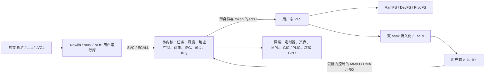

# NOS 微内核架构

<!-- Copyright (C) 2026 NOS contributors -->

默认构建使用跨架构微内核。旧 RTOS 源码与板级实现保留在原目录，经 `make legacy` 调用；旧平台不属于微内核验证结果。实现与验收的执行清单见 [EXECUTION_PLAN.md](EXECUTION_PLAN.md)，命令见 [QEMU_VALIDATION.md](QEMU_VALIDATION.md)。

## 特权边界

文件业务、节点、文件内容、文件描述符、FatFs 与 virtio 请求队列位于用户态服务中。内核检查用户范围和能力，复制消息并覆盖 sender/process/token 身份。消息有效载荷上限 64 字节，大块 I/O 由用户运行库分块。调试串口输出保留特权传输入口，普通文件与标准 FD 通过 VFS。

设备能力表示受信任的 I/O 域。当前没有 IOMMU；不能把 MMIO/DMA 能力授予任意不可信程序后，仍声称它无法利用设备访问其他物理内存。地址查询只接受本地址空间的有效可写缓冲区；服务退出必须先关闭中断、同步停止 DMA，再释放映射与物理页。

## 内核模块

| 模块 | 实现与契约 |
|---|---|
| `core.c` | 版本化 syscall 分派、用户复制、启动模式、受权执行与服务重启；测试结束入口仅在自测配置启用 |
| `task.c` | 代际 PID、独立进程与共享地址空间线程、wait/退出、孤儿回收、clear_tid、futex、异核取消 |
| `scheduler.c` | 32 个优先级、同优先级轮转、抢占、睡眠、每 CPU current 与固定空闲任务；CPU 0 维护全局 100 Hz 时钟 |
| `mutex.c` | 阻塞互斥锁、能力引用、代际句柄、所有者检查、多锁及传递优先级继承、循环等待检测 |
| `ipc.c` | 多端点授权/撤销、同步 call/recv/reply、IPC 优先级传播、超时/取消、请求 token 与生命周期通知 |
| `irq.c` | 同地址空间授权的 IRQ 对象、绑定、计数、单等待者、超时、屏蔽/确认和退出撤销 |
| `memory.c` | 清零物理页分配、地址空间引用计数、安全用户复制、映射事务回滚、VMA 范围变更、权限与配额 |
| `elf.c` | 有界静态 ELF/PIE 装载、段与入口校验、参数/环境/auxv/TLS、失败清理 |
| `arch/*/micro/` | 启动/异常上下文、MMU/MPU、UART/GIC/PLIC、缓存和 TLB 同步、SMP 引导 |

内核进入采用粗粒度全局锁，各 CPU 的用户任务能够并发执行。运行中的任务不能同时被另一 CPU 调度；异核取消延迟到目标 CPU 的安全入口处理。当前没有每 CPU 运行队列或负载均衡策略，不宣称具备大型 SMP 系统的扩展性。

## 对象与 ABI

`include/nos/abi.h` 固定 syscall 编号与 ABI 版本；`ABI_QUERY` 返回版本、字宽、消息大小和页大小。消息和指针使用本地字宽，32 位应用不能直接运行在 64 位 ABI 上。

PID、锁、IRQ 和端点带代际信息；对象类型有独立句柄范围，达到代际上限时退休，避免陈旧句柄重新变为有效。硬件功能查询与权限查询分别提供；旧 CAPS 接口保留兼容。锁和端点能力继承、授权、撤销均由内核检查。非 MMU 共享域的锁生命周期与 MMU 独立地址空间不同，不能把共享 SRAM 中的软件权限称为硬件隔离。

端点 0 是初始 VFS 服务入口，其他端点可由授权任务创建和委托。回复必须匹配当前请求 token；超时、取消或对端退出后，旧回复不能完成新请求。服务重启使用新的任务 generation，等待中的客户端收到错误；RAM 文件与原有 FD 不自动恢复，持久化数据须重新挂载。

Linux 兼容配置的 native 消息另带有界输入/输出 span，消息的 inline data 仍为 64 字节。IPC_XFER 只允许当前接收服务在调用仍等待回复时，以匹配 sender generation、token 和端点权限复制至多 512 字节；每次重新检查两端映射和权限。取消、超时、撤权、服务重启和旧 token 均不能留下可继续使用的跨地址空间读写权限。默认消息布局不变；兼容配置内的所有 native 客户端、服务与 gateway 必须使用相同构建配置，ABI_QUERY 暴露实际 message_bytes。

## 架构、内存与上下文

| 目标 | 地址转换 / 模式 | 用户上下文 |
|---|---|---|
| ARM Cortex-A15 `virt` | ARMv7 短描述符、用户/特权模式 | ARM 通用寄存器、VFP d0–d31/FPSCR、TLS；GNU soft-float ABI |
| ARM64 Cortex-A53 `virt` | EL1/EL0、三级页表 | 通用寄存器、完整 SIMD/FP、FPCR/FPSR、TPIDR_EL0 |
| RV64GC `virt` | M 引导、S 内核、U 用户、Sv39 | 通用寄存器、完整浮点/FCSR、TP |
| RV32GC `virt` | Sv32 或显式非 MMU 配置 | 32 位通用寄存器、64 位浮点寄存器/FCSR、TP |
| STM32F405 `netduinoplus2` | Cortex-M4 非特权线程、PSP；可选 MPU | 软件保存寄存器与异常帧，soft-float ABI |

MMU 进程使用独立数据/堆/栈，线程共享引用计数地址空间。地址空间可以比创建它的任务活得更久。用户代码 RX、数据 RW/NX；内核身份映射的代码/只读数据与可写数据分离，栈设有保护页。`munmap/mprotect` 支持范围拆分和 `PROT_NONE`；映射失败回滚已安装页表项后才释放物理页。不同 CPU 的权限变更需要同步 TLB，不能仅刷新发起 CPU。

编译器可在 freestanding 代码中生成 memcpy/memset 调用。`scripts/kernel_libgcc.py` 为内核生成单独命名空间的 libgcc，并把编译器内存调用重定向到内核运行库；用户 ELF 链接自己的辅助函数。独立 ELF 不依赖映射内建用户代码才能执行内核。`scripts/check_kernel_boundaries.py` 检查静态可解析的直接分支边界；间接调用仍需运行时验证。

非 MMU 模式使用实际物理地址和共享数据模型；RV32 RAM 的高位物理指针不能按“有符号返回值小于零”误判为 errno，指针错误仅保留最高 4095 个值。STM32 开启 MPU 后可检查内核区域、任务栈/映射的权限与执行禁止，内建用户全局数据仍共享。这不是 MMU 进程级的完整隔离。

## 有界资源配置

| 资源 | 当前默认值 |
|---|---|
| 任务 | MMU/RV32 为 12；STM32 为 6，包含服务、init 与每 CPU 空闲任务 |
| CPU | SMP 配置 1–4；STM32 固定 1 |
| 内核互斥锁 / 端点 / IRQ 对象 | 32 / 8 / 8 |
| VMA | MMU 16 段；非 MMU 4 段；范围拆分也消耗条目 |
| 分配上限 | MMU 单次映射 512 KiB，匿名虚拟区有界；非 MMU 单次 64 KiB |
| MMU 基础进程区 | 64 KiB：静态数据 24 KiB、基础堆 24 KiB、4 KiB guard、12 KiB 栈；可另映射线程栈/堆 |
| 物理页池 | MMU 默认 4 MiB；RV32 非 MMU 1 MiB；STM32 80 KiB；以配置头和链接断言为准 |
| VFS | 16 个节点、每文件 512 字节、每地址空间 11 个 FD（含 0–2）、2 条 256 字节管道 |

这些上限是显式资源预算。达到上限返回错误，不能以固定测试数据能运行推断为无限容量文件系统或通用桌面内核。改变 MCU 内存预算必须同时检查 ELF 段、内核栈、MPU 区域和链接布局。

`LINUX_COMPAT=1` 是独立的 MMU 兼容配置：32 MiB 物理页池、每地址空间 128 个 VMA、256 KiB 基础进程区与 128 KiB 用户模板上限、32 个 FD，RAM 文件可按需使用 8192 字节共享后端。默认 MCU/原生配置的内存与模板限制不因该配置而放宽。执行参数的实际字符串、NUL 和向量指针总预算为 128 KiB；内核使用静态 staging 和流式新栈构造，不将巨大参数表放到内核栈上。

## 应用、运行库与设备

`BUILD_MODE=selftest` 启动能力验证并返回测试退出状态；`BUILD_MODE=normal` 启动持续运行的 init 和串口 shell。独立应用从嵌入式 initramfs 装载，具备 argc/argv/envp/auxv、初始化数据、BSS 和 TLS。native ARM/ARM64/RISC-V MMU 使用静态 ELF；STM32/RV32 非 MMU 使用经过校验的 PIE 相对重定位。Linux 兼容配置另提供真实动态解释器和共享库装载。

Newlib 使用校验过的 4.5.0 源码构建动态重入与 retargetable locking 端口；线程通过内核 TLS 值取得自己的 `_reent`，不依赖跨 CPU 改写全局 `_impure_ptr`。库存 Newlib 只保留显式诊断回退，不能作为跨核重入安全证据。musl 1.2.5 的真实静态库通过 syscall 适配层调用 NOS，线程启动、futex 与退出必须覆盖其架构汇编中直接使用 Linux ABI 的路径。支持范围与未支持操作见 [POSIX_SUPPORT.md](POSIX_SUPPORT.md)。

用户态 VFS 支持目录与路径规范化、独立 open description、dup、unlink-open 生命周期、管道与挂载。virtio-blk 提供 legacy/modern MMIO、DMA、FLUSH 与 IRQ 完成通知；双 bank 后端使用 CRC 和代际提交，FatFs 使用仓库实现的用户态适配。详见 [设备与存储](../servers/drivers/README.md)。没有 IOMMU、热插拔或设备故障的透明事务恢复保证。

Lua 5.4 与 LVGL 9 复用仓库旧库，作为独立用户 ELF 运行；LVGL 验证真实软件渲染和像素变化。软件帧缓冲通过不等于 LCD、USB、GPIO 或真实开发板验证。旧专用 USB、显示、键盘板级代码仍需对应控制器/板卡的服务适配与硬件回归，不参与无模型平台的通过结论。

## Linux personality 与共享对象

ARM、ARM64、RV64 的 Linux personality 解码真实六参数 syscall ABI。内核保留原始 Linux 上下文，文件请求转入独立链接的用户态 gateway，再经 native IPC 调用 VFS；返回时恢复原帧后投递信号。用户态 ld.so 执行动态重定位、构造器及 dlopen，内核不承担文件系统业务或 libc 分配器。

Linux profile 的大定位读使用现有 512 字节 bulk 上限；VFS 对 OFD 副本读取，并向 runtime 的暂存区 STORE。runtime 仅在 RPC 成功且长度合法后复制当前块到调用方，避免 STORE 与回复之间取消时发布失败块；整次调用仍保留先前已完成块的短读语义。小读、pwrite 和默认嵌入式配置保留原协议，文件偏移不变。

fork 复制私有映射并保留共享映射的物理身份；exec 分阶段准备新地址空间，失败保留旧镜像，成功保留进程 PID 并替换上下文。处理器帧、signal mask、pending、sigreturn、TLS、robust futex 和取消机制分别处理。ARM 兼容配置还映射受控只读可执行的 Linux kuser helper 页；不因此允许任意高地址用户访问。

RAM 文件的读写和 MAP_SHARED 指向同一物理后端。只有可信 VFS 具有共享对象 broker 权限；每次映射得到绑定地址空间、对象 generation 和 FD 最大权限的一次性租约。成功和失败映射均消费该次授权，VMA 保存独立 maxprot；同进程此前获得可写映射不能提升后来只读 FD 的映射权限。已存在映射、尚未消费的有效租约和队列中的共享 futex 维持物理页身份，关闭 FD、unlink 和最后解除映射分别处理。进程共享 futex 用物理页身份及偏移匹配，允许不同虚拟地址同步。

兼容配置的 RAM/initramfs 路径上限为含 NUL 的 256 字节，双路径通过同一次受 token 约束的 span 传输，目录记录支持分片。默认配置仍为 64 字节；持久化格式的路径字段保留 64 字节并显式拒绝超长名称，不修改已有磁盘格式。执行路径先由用户态 VFS 处理 cwd、规范化与符号链接，再由内核装载 initramfs ELF；尚不等同于执行任意磁盘或 RAM 文件中的程序。

共享 RAM 文件即时保持页数据一致，msync 仍检查地址、flags 和完整映射范围；这不意味着持久化磁盘映射已经实现。截断后越 EOF 页的 SIGBUS、按需分页和交换仍是未完成的语义。

## 实现边界

当前仍是有界微内核系统。native Newlib/musl 与 Linux/glibc 两条路径分别验收，已实现动态链接、fork/exec、信号和共享文件的声明子集；完整 Linux ABI、完整 POSIX、网络协议栈、完整 TTY/作业控制、按需分页和交换尚未完成。C 库通过真实标准程序验证所声明范围，不支持操作应明确返回错误。逐接口边界见 [POSIX_SUPPORT.md](POSIX_SUPPORT.md)。

真实硬件与远端 CI 状态必须在验证报告中单列。QEMU 证明所选模型中的行为，不能代替板卡时钟、引脚、DMA 一致性、缓存和外设电气行为测试。

## 进程记录锁与生命周期查询

Linux profile 的文件记录锁驻用户态 VFS，以真实 inode 和带 generation 的进程组 ID 为键；线程共享锁，fork 不继承，exec 仅按实际 CLOEXEC 关闭释放相关 inode 锁。区间表有界，拆分/合并先生成候选，token 校验的回复成功后才提交；取消、坏回复和退出不得留下错误授予的锁。ARM 的旧 32 位和宽 64 位 flock 由用户态 gateway 分别转换，不把 libc 结构直接当成服务 ABI。

退出通知按任务槽合并，槽复用可能覆盖旧组的最终通知。受 PROCESS_QUERY capability 限制的 GROUP_ALIVE 返回完整组身份的 live-task 位，以及内核 IPC 中排队/已交付但尚未确认的 fork 引用位。VFS 在服务请求及延迟回复前，用同一内核临界区内的有界批量快照查询所有相关组，再清理无 live task 的锁与等待；仅当 fork 引用也归零时释放 FD 表。批量模式保留逐组查询的 capability、完整 generation 和 fork 引用语义，先复制并验证全部输入，再生成状态并复制结果；失败时 VFS 保留全部现有状态。fork 先继承 FD，下一次合法 RECV 确认已交付通知；无效 RECV 不能提前释放引用。兼容配置为这些有界待继承父组另外预留 FD 表，默认嵌入式配置保持原容量。

该查询提供生命周期机制，不把锁、FD 或文件系统业务放入内核。自测镜像仅允许初始 init 为测试观察者授予查询 capability；正常启动镜像保持原授权策略，普通客户端不能自行获取该权限。
