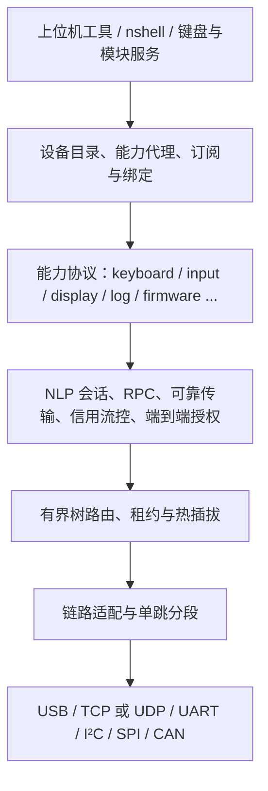

# NLP 1.0 协议设计草案

<!-- Copyright (C) 2026 NOS contributors -->

状态：**设计提案，尚未接入 NOS 固件**。日期：2026-10-23。NLP 全称 NOS Link Protocol，统一使用 NLP；本设计将需求中的“nlk”视为同一协议的名称笔误。本文中的 MUST、SHOULD、MAY 分别表示必须、建议、可选；版本进入实现互通验收前仍可调整。

NLP 是运行在用户态的分布式软总线：同一设备可以通过 USB、Wi-Fi/IP、UART、I²C、SPI、CAN 接入，公布多个有独立数据格式的能力，并转发下级设备。载体地址、设备身份、能力类型和业务权限各自独立。操作系统、工具和模块通过相同的设备/能力 API 访问它们。

## 文档与边界

| 文档 | 内容 |
| --- | --- |
| [报文与会话](wire.md) | 字节布局、可靠性、流控、RPC、编码与版本兼容 |
| [载体绑定](transports.md) | 发现入口、分帧、分段、I²C/SPI 主从、CAN 与 USB |
| [标准能力](capabilities.md) | 设备管理、输入、键盘、改键、显示、日志、nshell、升级及无线模块 |
| [信任与授权](security.md) | 身份、配对、端到端保护、重放、权限和固件信任链 |
| [NK60 与开发计划](implementation.md) | 拓扑、输入聚合、现有代码边界、资源目标、阶段验收 |
| [机器可读注册表](../../../protocols/nlp/v1/registry.json) | 版本、字段、类型 UUID、操作码及资源上限 |
| [协议向量](../../../protocols/nlp/v1/vectors.json) | 固定报文、CRC 与 UART/TCP 封装样例 |

注册表位于仓库根目录 `protocols/nlp/v1/`，上表的相对链接按本目录定位。参考工具 `scripts/nlp_codec.py` 只验证明文报文和载体封装，**没有实现发现、路由、密码学、升级或 nshell**。生产实现不得把它当成已认证的 NLP 栈。

## 1. 设备与能力

**Device** 是具有稳定身份和生命周期的逻辑节点。它包含：

- `device_uid`：128 位永久身份，不能使用易变化的 IP、MAC、CAN 地址或树中路径替代。生产设备应绑定设备公钥；实验设备可持久配置 UUID，并明确未认证身份。
- `boot_id`：64 位本次启动标识；由安全随机源或持久单调启动计数生成。重启后所有旧会话、请求和输入租约失效。不能以未播种 PRNG、定时器或未初始化内存生成安全随机数。
- `fabric_uid`：128 位总线域标识；`fabric_epoch`：该域 32 位持久单调代次。协调者重启必须推进代次；回绕前创建新 fabric，不能重新接受旧租约。
- `node_id`：域内租约分配的 16 位短地址，1 为协调者，2..65533 为节点，0 无效，65534 为尚未分配，65535 为单跳本地广播。短地址不提供身份认证，不能跨 fabric 复用。
- `descriptor_revision`、产品/硬件/固件信息、端口和能力目录；名字用于展示，不作为路由或权限依据。

**Capability** 类似 USB function：某个设备上的一个独立功能实例。身份是 `(device_uid, boot_id, capability_id)`，类型由 128 位 `type_uuid` 表示，另有 major/minor 版本、功能位、格式描述、资源限制和所需权限。同一设备可暴露两个 display 或多个 input 实例；同一能力可有多个授权消费者。

`capability_id=0` 为内置设备管理/客户端端点，不计入普通能力目录；1..65534 为普通实例，65535 保留。实例 ID 在同次启动内不复用。客户端可以从端点 0 调用远端能力，无须先把自身伪装成一个服务。会话绑定双方 UID/boot、端点、能力类型和协商版本，报文中的短 ID 只是该绑定的索引。

NLP 能力是业务服务接口，**不等于** NOS 内核的 `NOS_CAP_*` 权限位。发现某项能力不意味着获得访问权。

## 2. 分层

载体适配器负责相邻节点接收、物理地址和有界分段；路由器只转发完整 NLP PDU；端到端会话负责业务确认、去重和权限；能力自行定义数据格式。v1 不做任意大小的端到端报文重组，大对象由升级块、显示 tile 或流式数据显式分块。

## 3. 自发现与加入

物理端口状态为 `DOWN → PROBING → NEIGHBOR → JOINING → ACTIVE`，错误进入退避或隔离。上位机/协调者上的目录状态为 `SEEN → VERIFIED → LEASED → ONLINE → STALE → REMOVED`。公开发现与配对授权分开进行。

1. 适配器发现相邻候选端点；串口/SPI/I²C/CAN 必须先满足各自地址、片选或主从约束，不能用广播协议解决电气地址冲突。
2. 单跳 `HELLO/HELLO_ACK` 交换版本区间、UID、boot、最大 payload、载体功能、端口角色和发现 nonce。未加入的报文不得越过路由器。
3. 验证邻居身份或记录其明确的物理信任模式。候选节点申请加入指定 `fabric_uid/epoch`，公布父端口与祖先列表。
4. 协调者校验无环、身份冲突和资源配额，分配短地址/租约，把路由依次安装到祖先；安装确认后才发送 `JOIN_ACCEPT` 并公布 ONLINE。
5. 客户端按 `descriptor_revision` 分页读取设备及能力目录。列表响应带 revision/cursor；目录变化返回 STALE，客户端重新读取，不混合两代结果。
6. `CAP_ADDED/CHANGED/REMOVED` 与设备/拓扑事件驱动缓存更新；订阅丢失、事件序号跳变时全量校准。撤销能力先关闭其会话、撤销输入，再发目录事件。

默认邻居心跳 5 秒、节点租约 15 秒。链路明确断开时立即传播离线事件，无须等待租约。输入有单独的短租约，不能因设备目录还在线而保持按键不释放。发现、目录项和拓扑事件均有限额、分页和速率限制。

## 4. 多层级联与路由

v1 使用**一个协调者控制的有根树**，允许多载体、多层子设备以及备用物理连接；同一节点同时只有一个 ACTIVE 上行父节点。任意 mesh、多个协调者合并和跨 fabric 透明漫游不属于 v1。

- 协调者维护全域目录；中间节点只保存父节点、直接邻居和已安装的子树路由，不要求 MCU 复制全网目录。节点声明最大邻居、路由、层数和缓冲区，资源不足返回 NO_SPACE。
- 路由依据 `(fabric_uid 所绑定的链路域, epoch, destination_node)`；源、目的 capability ID 对中间节点没有业务含义。父节点是默认上行；从父节点收到却没有下行路由的包返回 NO_ROUTE，不能再发回父节点。
- 从子端口来的源地址必须属于已批准的该子树；选出的出口不得等于入口。广播不跨路由器；跨树发现由协调者查询与定向目录响应完成。
- `hop_limit` 默认 16，v1 最大树深度 8，每次转发减一；hop=1只允许本地递送，不能再转发，0丢弃。路由错误只单播给已知发送端，限制频率，不对广播/错误再次生成错误。
- HELLO 看到自身 UID、祖先重复、重复 UID/不同设备公钥或租约冲突时隔离该路径。备用端口不转发；节点不能仅凭更小链路代价自行改变父节点。
- 切换父节点执行准备、撤销旧路径、提交新路径。v1 保守地关闭受影响会话、重新计算路径 MTU，并重新打开输入绑定；不承诺无感迁移或跨路径 exactly-once。
- 协调者消失时，已有本地功能可继续，远端租约到期失效；v1 不自动选举。新协调者/新 epoch 要重新加入，旧短地址和缓存不得继续生效。

转发成功、CAN ACK、TCP write 成功和 NLP 传输 ACK 都不是“远端业务执行完成”；只有能力响应才能表达执行结果。

## 5. 生命周期与兼容

设备重启、epoch 变化、能力移除、授权撤销、路径 MTU 下降和会话关闭均使旧句柄失效。客户端库返回 DISCONNECTED/STALE/OUTCOME_UNKNOWN，不能自动重放 shell 字节、按键边沿、重启或升级提交等副作用。

wire major 不同不能互通；能力 major 不同不能打开，minor 取共同支持版本并协商功能位。未知可选 TLV 可跳过，未知必须 TLV/功能必须拒绝。厂商使用自己的 UUID 命名空间，不能抢占 NOS 标准类型/操作码；代理必须保留真实的 origin 和版本。

历史 `4c31189:app/server/ndk/` 使用 USB 专用 8 字节 NDK 头，没有本设计的设备、能力和路由模型；其升级写 Flash 调用为注释占位。NLP v1 不承诺旧 NDK wire 兼容，不静默降级；如需迁移，只能通过显式、限权的 legacy adapter。
