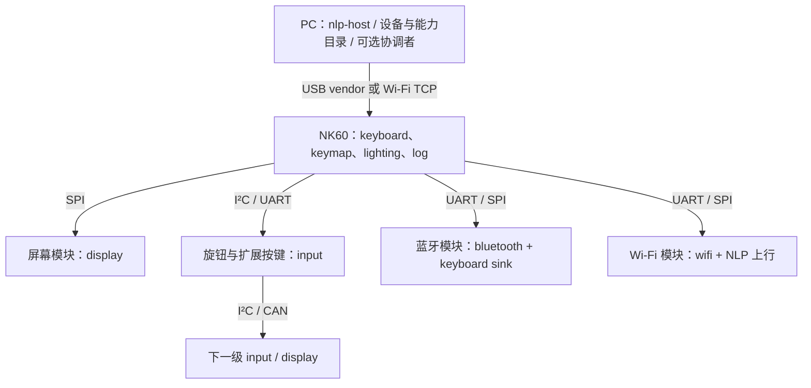

# NLP 的 NOS/NK60 接入与开发计划

<!-- Copyright (C) 2026 NOS contributors -->

本文是实现蓝图。已有 NK60 固件是 `c729dae` 的 USB HID/UART维护版本；本次仅提供协议设计、注册表和参考格式检查，没有启用 NLP 功能或修改该固件。

## 1. 目标拓扑



PC在线时可作协调者，NK60为多端口路由器与输入聚合器。离线键盘也可配置NK60为协调者，蓝牙模块作为sink/上行桥；两个模式切换须显式选fabric、撤销旧租约，不能让PC与NK60同时发号。独立模块可使用NOS或其他RTOS/裸机，只要实现相同wire与能力profile。

原生NLP模块有自身UID/boot、能力与认证；普通I²C/SPI芯片可由本地代理暴露功能，明确owner/origin，不伪造独立安全身份。多层设备在上位机保持各自身份，不压扁成“NK60下面第几个串口”的永久ID。

## 2. 代码边界

后续建议目录（当前尚未创建生产模块）：

```text
servers/nlp/
  core/          帧、会话、信用、请求、目录、租约
  routing/       协调者、树路由、源约束、热插拔
  transports/    USB/IP/UART/mailbox/CAN适配
  capabilities/  能力分派、log/shell/update/input/display代理
include/nos/nlp/ 设备/能力客户端API与无指针wire定义
apps/nlp-host/   PC发现、配对、查询、终端、升级和拓扑工具
```

NLP目录、路由、重传、profile与日志/shell/升级业务留在用户态。内核继续只提供IPC、受权设备访问、DMA/IRQ、内存和调度；不把协议parser或远程命令塞进异常路径。公用codec不依赖NOS，适合其他MCU移植。

客户端API围绕 `find_devices / list_capabilities / open / call / subscribe / read / write / close`，句柄带boot/session generation；cancel和disconnect有明确结果，不能透传远程指针。本地NOS IPC handle和网络capability_id不能共用命名空间。

## 3. NK60 输入和输出

现有 `kb_scan(uint64_t)` 只描述固定61键，不能把扩展按键直接塞进剩余3位。应增加来源化输入适配层：`source(uid,boot,cap,binding) + control_id → action`，本地矩阵也作为一个来源；每来源维护按下集合，合并后驱动当前动作/层/宏/报告引擎。

- 旋钮/按键模块加入后只显示为可绑定能力，默认不自动产生全局输入。用户配置映射到音量、层、快捷键或屏幕菜单；错误模块不能执行shell/升级。
- 同一usage用来源引用计数合并；断线、租约到期或移除只释放该来源。短租约、全量刷新、全松开屏障和队列溢出处理与现有防卡键策略一致。
- owner管理解决USB HID、NLP host和蓝牙sink多输出问题。默认LOCAL_USB；host调试订阅只观察，不额外向OS注入键盘；切换sink先全释放旧sink，再等所有来源全松开。
- 屏幕显示层、连接状态、配对/升级进度等，经display tile能力提交。字体/布局可在NK60或模块侧按已声明profile处理，不默认把整屏帧缓冲放进F401 RAM。
- 蓝牙模块的配对/连接与keyboard sink分开授权；Wi-Fi模块可提供新的上行邻接。无线断线会使相关绑定失效，不能无限缓存按键再集中重放。

## 4. F401 资源目标

这是后续编译/压测要验证的目标，不是已测量结果。当前固件bin约47KiB、64KiB SRAM、静态区最高0x20009e88，应用Flash限前128KiB；不能使用未确认的尾部内部Flash或覆盖外置NOR配置区。

| 资源 | MCU基础配置目标 |
| --- | --- |
| 最大payload / 完整加密PDU | 128 / 196字节 |
| peer / 路由 / 级联深度 | 4 / 16 / 8 |
| 本地普通能力 / 业务session | 8 / 8（按需打开，不预留8个大消息队列） |
| 活跃安全association | 最多4；握手workspace全局串行复用 |
| 每session活跃channel / 最大可靠窗口 | 2 / 2；较大配置才允许4通道/8窗口 |
| 重组槽 | 总2个、每peer最多1个，196字节/槽 |
| 完整PDU数据池 | 总6槽共享，不按peer×session×window相乘；先分配槽再授信 |
| 预认证握手 / 在途RPC | 全局1 / 每session2，总量受固定池限制 |
| 日志额外ring | ≤512字节，满后丢弃并计数 |
| NLP新增静态RAM / 用户栈 | 目标≤10KiB / 独立4KiB栈（或经验证的协作服务） |

只有实际链接map、栈使用和高水位符合预算才能启用该配置。共享消息池须保留ACK/CLOSE/释放事件槽；同时打开8session不意味着每个都授予2帧信用。认证/升级hash和外设轮询不可阻塞USB/矩阵；超时和poll都有上限。

PC/大MCU配置可支持payload1024、更多会话和全网目录；能力与载体逐条协商取最小值，不把PC资源假定成每个级联模块都具备。

## 5. 分阶段实施与完成条件

| 阶段 | 交付 | 完成条件 |
| --- | --- | --- |
| P0：协议冻结 | 本次草案、注册表、固定向量、参考codec | 布局/CRC/封装与测试一致；open问题有明确状态；无固件“已支持”误报 |
| P1：最小链路 | portable C codec、有界池、UART与USB vendor、host CLI、device/log | 两个独立实现互通；粘拆包/丢包/CRC/超长/断开均安全；原HID及扫描回归通过 |
| P2：会话和授权 | Noise库接入、配对、管理/业务会话、RPC/信用/撤销 | 独立测试向量、nonce/重放/降级/资源耗尽、可靠重复副作用检查；安全熵方案可验证 |
| P3：发现与级联 | 协调者、租约、目录、热插拔、UART/I²C/SPI/CAN、多层host拓扑 | 8层和资源边界、环路/重复UID/父切换、MTU变窄、迟到completion；CAN commissioning独立总线验收 |
| P4：键盘与模块 | 来源化input、keyboard/keymap/lighting、显示tile、output owner | 两来源同usage、掉线全释放、旋钮不重放、无双重输入、改键原子提交、UI保存状态正确 |
| P5：终端/升级 | 通用NOS nshell代理、受权固件staging和可恢复boot流程 | 终端流控/取消/权限；manifest/兼容/签名/断点/断电/回退；不具备安全boot的板返回UNSUPPORTED |
| P6：无线与扩展 | BT/Wi-Fi profile定稿、模块适配、低功耗 | 先完成profile字节格式，再双端互通；断链/重连/凭据保密/输入租约和功耗验收 |

P1可先做受限物理链路的device/log互通，但SHELL、FIRMWARE_APPLY、RADIO_CONFIG和跨信任域输入必须等P2，不以“先能用”静默开放高权限操作。

## 6. 验收矩阵与故障注入

- Wire：大小端、保留位、截断、超长、CRC、未知必须TLV、重复项、版本拒绝；参考向量与独立C/host实现逐字节一致。
- Session：分方向计数、不回绕、信用不可撤回、ACK不等于业务成功、重传不重新执行、缓存淘汰OUTCOME_UNKNOWN、断电后旧会话失效。
- Transport：TCP粘拆、UART delimiter恢复、I²C短交易/PEEK重读/token迟到、SPI CS提前释放、CAN重复/乱序/token复用/bus-off；CAN匿名枚举的相同ID零数据应答须实测。
- Topology：多层混合载体、备用边环路、双协调者、UID冲突、路由资源耗尽、邻接/epoch变化、模块重启和proxy能力移除。
- Profiles：按键最终释放、双路径owner、两来源引用、显示半帧、日志淹没、终端Ctrl-C/退出、升级每个擦写/元数据阶段断电。
- NOS：涉及内核/ABI/内存时执行既有完整QEMU回归；仅设计和host参考codec不需要重跑内核80组，更不能据host模型声称物理模块已适配。

当前仍无可访问实板。首次实际接入优先USB+UART，然后I²C/SPI小模块，再CAN和无线；所有模型、固件编译、真实总线/USB枚举与安全审计分别记录。

## 7. 本次设计检查

`python3 tests/host_nlp_protocol.py` 运行纯host参考格式检查；`scripts/nlp_codec.py` 可打印/检查固定明文报文与UART/TCP封装。它们不实现路由、会话、权限、Noise或任何能力业务。测试通过仅表示草案中的字节布局、注册表和向量彼此一致，后续P1..P6不能因此标记完成。

当前检查包含17组测试、7个固定PDU向量、4个COBS边界向量、600次确定种子的报文往返和1000次噪声输入检查；独立CRC oracle不调用参考CRC实现。每次运行将日志、退出状态及12个输入文件的前后SHA256放在`out/microkernel/host-nlp-protocol/<UTC时间>/`。CAN枚举只验证UID前缀模型与ID编码，未验证实际仲裁、时序或硬件发送取消；AEAD向量仅检查AAD头规范化，不执行密码学。
