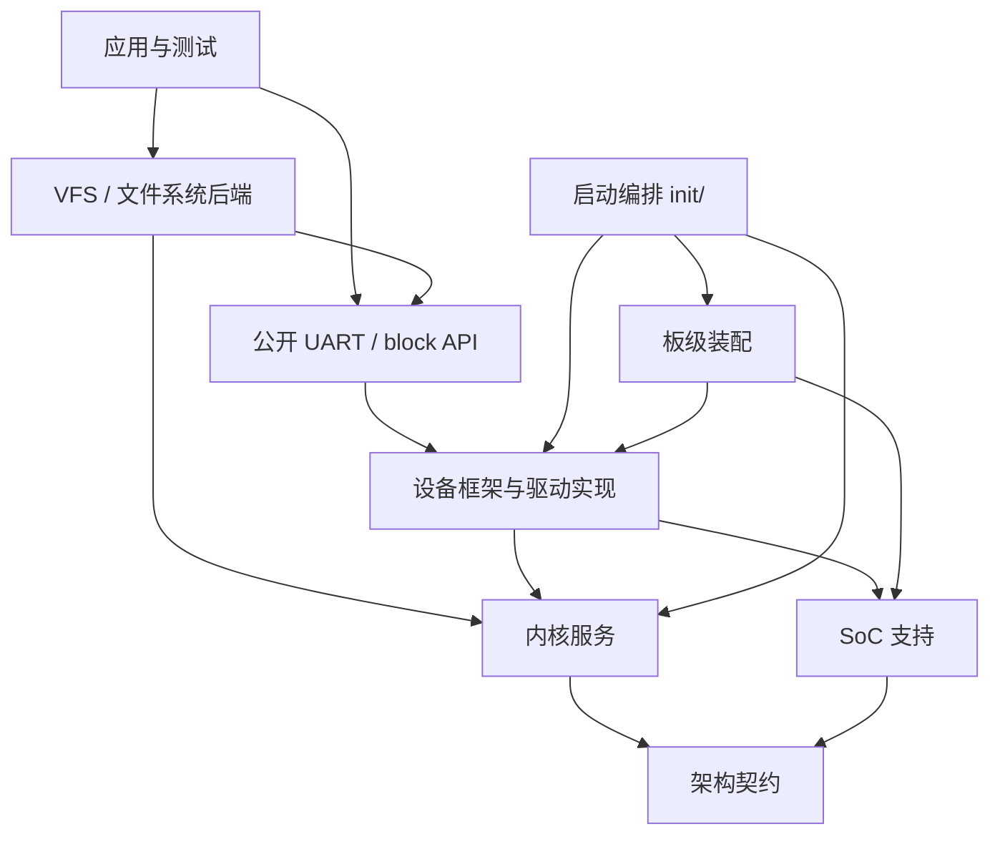

# NOS 单体内核重构设计（收口版）

**日期：** 2026-10-01

**状态：** 设计已补齐，待评审；不代表实现或运行验收已完成。

**核对基线：** `master`，`7ae39ba`；同时记录本地未跟踪文件对构建的影响。

**范围：** 第一阶段架构、初始化、静态设备、UART、block、VFS/FatFs、迁移与验收。

本文接续并取代 [2026-07-19 设计](2026-07-19-nos-refactor-design.md)中的第一阶段目标契约。既定的单体内核、静态设备表、原地渐进迁移和 `qemu-stm32` 金标方向保留。原 [实施计划](../plans/2026-07-19-nos-refactor.md)保留历史任务，不应按未勾选框重新实现已有功能；后续工作以本文第 10 节为准。

## 1. 结论与范围

NOS 继续采用可裁剪的单体 RTOS：内核负责调度、IPC、内存与时间；设备框架管理静态设备生命周期；驱动通过内核服务与架构/SoC 接口访问硬件；板级只负责装配。文件访问统一经 VFS，FatFs 通过 block API 访问介质。

第一阶段完成的判据是：**公共依赖无板级泄漏、初始化上下文明确、设备错误可查询、金标在真实任务上下文中完成 FatFs/ramdisk 读写与负例验证，并由自动化准确判定成功或失败。** 目录移动、可链接和一条 `vfs_smoke OK` 都不足以单独证明完成。

### 1.1 路径比较

| 方案 | 收益 | 代价与不足 | 结论 |
| --- | --- | --- | --- |
| 在已有 M1–M4 上补齐契约与验证 | 保留调度器、内存管理和已迁移模块；变更可逐包回退 | 需要限期维护旧接口适配层 | 采用 |
| 只整理目录与命名 | 改动小，短期易合并 | 无法解决初始化依赖、文件生命周期和验收假阳性 | 不满足出口标准 |
| 重写内核、设备与 VFS | 可以重新统一所有接口 | 同时失去既有板级与调度基线，验证面过大 | 不纳入本阶段 |

### 1.2 范围边界

- 保持 UP、现有优先级与时间片调度语义；不增加 SMP、用户态隔离、微内核服务化。
- 金标为 `ARCH=arm` / `qemu-stm32`；`nk60-v2_config` 已回迁，作为构建兼容目标保留，硬件运行另行验收。
- UART 仅要求轮询控制台；IRQ/DMA UART、SPI/I2C/USB/display 的完整设备迁移另开子项目。
- 文件系统只承诺一个根挂载、一个 FatFs 卷、同步块 I/O 和最小文件 API。已有 procfs/sysfs/子挂载代码不等于本阶段完整支持。
- 不引入完整 Device Tree、页缓存、分区管理、热插拔或在线卸载。
- ARM64 仅对齐公共契约与明确的“端口未完成”构建诊断；不宣称可启动。
- 本文代码标识中标为“新增/目标”的内容是后续实现要求，不是当前已提供的 API。

## 2. 当前实现与差距

下表依据当前源码，区分已经存在的机制与仍需完成的约束。

| 区域 | 已存在的实现 | 尚未满足的设计要求 | 证据 |
| --- | --- | --- | --- |
| 分层与目录 | `soc/stm32f1`、`soc/stm32f4`；sched/task/ipc/irq 已归位 | 公共 init 头仍传递包含板级头；本地旧头可以抢占 SoC 头 | [init.h](../../../include/kernel/init.h)、[SoC 包装头](../../../soc/stm32f1/include/soc/stm32f1xx.h) |
| 启动 | early hook、mm、sch、init level 已接入 | `EARLY` 未执行；`APPLICATION` 在 `sch_start` 前执行；旧 `.task` 链仍活跃 | [main.c](../../../init/main.c)、[init.c](../../../init/init.c) |
| 静态设备 | `DEVICE_DEFINE`、ready/init_res、typed UART/block API | 仍混合 legacy ops、引用计数和动态注册；失败设备未进入成功注册链表 | [device.h](../../../include/kernel/device.h)、[device.c](../../../drivers/base/device.c) |
| 初始化排序 | 按 level 扫描链接段 | 同级依赖只能依赖链接顺序；失败日志缺少入口名称；未防重复调用 | [init_levels.c](../../../kernel/init_levels.c) |
| UART | 金标控制台使用 STM32 UART 静态设备 | 金标引脚与波特率配置仍写在通用驱动文件中；发送轮询无上限 | [uart_stm32.c](../../../drivers/serial/uart_stm32.c) |
| block | 512 × 512 字节 ramdisk；read/write/get_info；越界检查 | 无持久化同步契约；原始扇区 smoke 在文件系统挂载后执行 | [block.h](../../../include/drivers/block.h)、[ramdisk.c](../../../drivers/block/ramdisk.c) |
| FatFs | diskio 已只调用 block；根挂载失败可回退 ramfs | 挂载失败可能自动格式化；卷号与设备绑定全局硬编码；关闭错误被吞掉 | [diskio.c](../../../fs/fatfs/diskio.c)、[fatfs_vfs.c](../../../fs/fatfs/fatfs_vfs.c) |
| VFS | `nos_open/read/write/close` 与 16 项全局 fd 表 | fd/路径状态缺少统一并发保护；访问模式未完整执行；失败路径与对象回收需收口 | [vfs.c](../../../fs/vfs.c)、[fs.h](../../../include/fs/fs.h) |
| 文件测试 | 创建、写入、关闭、重开、逐字节回读 | 没有断言真实 FS 后端，ramfs 回退也可能通过；未证明调度已启动 | [vfs_smoke.c](../../../fs/vfs_smoke.c) |
| CI | 构建任务执行依赖检查和金标编译 | test/lint 仍是 echo；没有 QEMU 超时、失败标记或结果解析 | [.gitlab-ci.yml](../../../.gitlab-ci.yml) |

`_FS_REENTRANT=0` 是当前 [FatFs 配置](../../../fs/fatfs/ffconf.h)的事实；`option/syscall.c` 仍是 Windows 示例，不能视为已接入 NOS mutex。

### 2.1 本轮验证事实

- `bash scripts/check_layer_deps.sh`：退出码 0。该脚本主要扫描直接 include，未覆盖上述传递依赖和头文件遮蔽。
- 本地工具：Arm GNU Toolchain 14.2.Rel1；QEMU 10.2.0，`-machine help` 包含定制 `nos_stm32`。
- 在独立临时 `out-dir` 中执行 `make qemu-stm32_config`：成功；`make -j4`：退出码 2。
- 失败日志显示 `board/qemu-stm32/inside-include/stm32f10x.h` 被包含，并与 `arch/arm/include/asm/types.h` 的 `s32/u32` 定义冲突；该旧板级头是本地未跟踪文件。已提交 SoC 头是否可独立全量构建，本轮未验证。
- 因本轮未产出成功构建的镜像，未进行 QEMU 运行验收，也未验证 NK60 硬件。
- 本轮保留未跟踪文件，不用删除用户文件的方式制造“干净通过”。

## 3. 分层、依赖与目录契约

依赖不是“内核 → 驱动 → 板级”的单向直线。启动编排负责装配；驱动可以使用内核服务，内核不得依赖某个具体设备实现。



图中 API → 实现表示运行时派发；公共 API 头不包含实现私有头。内核 console 可依赖公共 console/UART 契约，不包含 STM32 寄存器定义。

| 层 | 负责 | 允许依赖 | 禁止 |
| --- | --- | --- | --- |
| `arch/<arch>` | 上下文保存恢复、异常入口、IRQ 状态、屏障、CPU idle | 基础类型与少量内核回调契约 | 包含具体板级头或 STM32 外设头 |
| `soc/<soc>` | 厂商库、寄存器、时钟/复位、片上中断号 | 架构契约、基础公共类型 | 依赖某块板的引脚与应用策略 |
| `board/<board>` | 内存图、向量实例、链接脚本、引脚与设备实例装配 | SoC、驱动配置接口、公共内存注册接口 | 再复制整棵厂商库 |
| `kernel/` | sched/task/ipc/mm/irq/timer、日志与通用 console | `<asm/*>`、公共通用接口 | 板级/SoC 私有头、具体驱动实现 |
| `drivers/base` | 设备目录、状态查询、typed API 校验 | 内核基础服务 | 板名硬编码 |
| `drivers/<subsystem>` | UART/block 等实现 | 公共内核 API；硬件驱动可包含对应 SoC 头 | 通过 board 头获取引脚与设备配置 |
| `fs/` | 路径、fd、FS 后端、FatFs 适配 | 内核服务与公共 block API | STM32、SPI-SD、board 头 |
| `init/` | 启动顺序、必要资源失败策略 | 上述各层的公开装配接口 | 把策略隐藏在任意设备回调中 |
| `app/` | 应用任务与验证 | 公开子系统 API | 直接使用 FatFs 或寄存器 |

### 3.1 目录和公共头

保留已有 `kernel/{sched,task,ipc,mm,irq}`；`kernel/timer.c` 暂不为目录整齐单独搬迁，拆出 timer 子模块时再迁。保留 `fs/vfs.c`，并发与生命周期契约稳定后才按职责拆文件。

`include/kernel/init.h` 只保留 init 元数据和宏，不包含 `<board/init.h>`；通用板级 hook 声明集中在 `include/kernel/board.h`，由 `init/` 使用。`include/drivers/*` 不暴露厂商寄存器类型。STM32 专用设备配置可以放在独立配置头，由 board 和该驱动共同包含，不能被通用 UART 头传递引入。

板级保留向量表实例与内存布局；共用上下文切换和异常处理逻辑归 arch。不要求将含 SoC IRQ 名称的整个向量表硬塞入通用 CPU 层。

基础 `size_t/ssize_t/addr_t` 的定义收口到一处，指针宽度随架构变化；删除 FS 头的重复基础类型定义应作为独立迁移提交。保留目前构建的 `-std=gnu11`，源码按项目 C99/GNU99 风格维护，本阶段不顺带切换语言标准。

## 4. 启动与初始化契约

### 4.1 唯一目标时序

```text
reset_handler
  → 初始化栈、复制 .data、清零 .bss
  → 必要的 SoC SystemInit / C 运行时准备
  → nos_start
      → arch_early_init → board_early_init → EARLY
      → cpu_init → arch_init → board_init
      → PRE_KERNEL_1（轮询 UART 就绪）
      → console_init → kernel_log_init
      → mm_node_early_init → mm_init → pid_init → sch_init
      → PRE_KERNEL_2（仅不阻塞的准备）
      → sch_start
          → idle/core 引导任务
              → POST_KERNEL（设备及可阻塞子系统初始化）
              → vfs_init → 指定根文件系统挂载
              → board_late_init
              → APPLICATION（应用注册/测试）
              → 迁移期 legacy task_init_call
```

保留现有函数名 `sch_init/sch_start`，不为命名一致另造 `sched_start`。`SystemInit` 与 board early hook 的职责必须避免重复时钟配置。清 BSS/复制 data 必须先于访问静态 C 对象的 hook；不是在 hook 之后再清零。

当前 idle 创建 core 的机制可继续使用，但 `POST_KERNEL` 到 legacy init 的顺序必须由 core 中一个明确入口负责。core 返回后的任务回收需保留现有 task 退出机制；正常 `sch_start` 不返回。

### 4.2 上下文约束

| 阶段 | 堆可用 | 当前任务有效 | 可阻塞 | 允许的工作 |
| --- | --- | --- | --- | --- |
| EARLY、PRE_KERNEL_1 | 否 | 否 | 否 | 静态状态、MMIO、有限轮询；不取任务 mutex |
| PRE_KERNEL_2 | 是 | 否 | 否 | 分配和创建未执行任务、准备数据结构；不等待 IRQ/任务 |
| POST_KERNEL | 是 | 是 | 是 | 设备依赖检查、同步 I/O、FS 准备 |
| APPLICATION | 是 | 是 | 是 | 依赖已就绪子系统的应用注册、有限测试 |

所有 init 回调都必须返回，长期循环由创建的任务执行。ISR 不调用可睡眠 mutex 或 VFS。调度器就绪前屏蔽会触发调度的中断；架构层负责使能时机，不能仅凭“tick 寄存器已设置”推断调度可用。

POST_KERNEL 创建的驱动内部任务只能使用已就绪资源，不得提前访问尚未挂载的 VFS。依赖文件系统的应用统一在挂载结果发布后的 APPLICATION 或 legacy 应用阶段启动；需要文件系统的应用在挂载失败时跳过启动并记录原因。

console 之前的初始化失败记录到静态结果表，console 就绪后输出，避免依赖尚未初始化的日志缓冲。内存、调度基础和金标 console 属于必要资源，失败时停止正常启动并留下可诊断错误；可选 FS 失败允许保留 console 和调度，但金标验收必须失败。

### 4.3 Init 元数据与排序（新增目标）

- 为入口补齐唯一名称、level、`0..255` priority、执行状态、返回码；保留函数返回 `0/-errno`。
- 增加 `SYS_INIT_PRIO(fn, level, priority)`；现有 `SYS_INIT(fn, level)` 迁移期等价于 priority 128。
- 按 level、priority 升序执行；同 priority 按唯一名称排序，只用于可复现，不表达依赖。有依赖的两个入口必须使用不同 priority 或不同 level。
- 使用静态表扫描选择下一入口即可，不在启动前引入动态分配；链接段必须 `KEEP`，并验证条目对齐、边界和数量。
- 每个入口最多执行一次；重复运行 level 不重复初始化成功或失败对象。普通启动不做隐式重试。
- 保留 `sys_init_run(level)` 调用形态；增加可查询的阶段结果接口（目标 `sys_init_result(level)` 返回阶段首个错误），同时保存每条入口错误，供启动策略和测试读取。
- 依赖缺失返回 `-ENODEV`，保持未就绪，不无限重试；无动态依赖图和循环依赖解算器。依赖错误由验收用例暴露。

## 5. 架构与板级契约

保留 `arch_early_init/arch_init`、`arch_irq_save/arch_irq_restore` 和现有栈/切换接口，不同时建立 lock/unlock 与 save/restore 两套公开命名。`arch_irq_restore(flags)` 必须恢复原状态，支持嵌套临界区，不能无条件开中断。

CPU 异常初始化归 arch；外设中断路由、优先级选择归板级/驱动装配。不得由 `board_init` 和 `arch_init` 重复初始化同一 CPU 状态。任务控制块和汇编使用的栈布局需有尺寸/偏移检查，跨文件重构不改变二进制契约。

- `board_early_init`：必需的早期板级准备，不使用堆和任务锁。
- `board_init`：板级资源和内存描述接入；内存描述必须先于 mm 枚举消费。
- `board_late_init`：在 core 任务中、基础设备/根挂载尝试之后执行。
- 设备实例的引脚、基址、时钟和 console 名称来自 board 静态配置；驱动实现不硬编码 `qemu-stm32`。

`nk60-v2_config` 是真实 Make 入口，`CONFIG_BOARD="nk60"` 是目录选择，不能写成 `nk60_v2_config`。金标 ramdisk 占用 256 KiB，当前 QEMU 链接脚本配置 256 MiB RAM；这些是模拟机配置，不能作为 STM32F401 的内存预算。NK60 默认不带金标 ramdisk/FS 测试，必须独立检查 map 中的 Flash/RAM/堆/栈边界。

ARM64 的 IRQ、类型、屏障、上下文等关键能力不允许靠返回成功的空实现伪装可运行。未完成端口必须在配置/构建时明确拒绝可启动镜像；契约编译检查通过与端口运行通过分开记录。

## 6. 静态设备与 UART

### 6.1 对象与生命周期

沿用 `DEVICE_DEFINE` 的静态实例形态，区分只读 config/API 与可写 data/state。目标静态设备目录包含所有声明的设备，不仅是成功注册的设备，以便初始化失败后仍能按名称查询 `init_res`。

```text
DECLARED → INITIALIZING → READY
                       → FAILED（保存负 errno）
```

框架预检查名称唯一、必需指针和 API 类型；错误发生在触碰硬件之前。回调失败后驱动回滚已申请的 IRQ/缓冲区或关闭半初始化外设，设备保持 FAILED。失败信息不得被后来执行的入口覆盖。

- `device_get_binding(name)` 返回静态对象的借用指针；可能未 ready，调用方必须检查 `device_is_ready`。未知名称返回 `NULL`。
- 静态对象在整个系统运行期有效，不由调用方释放，也不增加隐式引用计数。
- 为设备增加子系统类别，typed helper 在派发前检查类型、ready 和方法存在；避免把 UART 的 API 表强转成 block API。
- 静态设备不允许运行中注销；目标返回 `-EBUSY`。状态只在串行启动时发布，发布之后只读；本阶段不设计运行中恢复或热插拔。
- 原 `device_register/find_by_name/inc/put/ops` 放入明确的 legacy 兼容边界。金标不调用旧手工注册 API；NK60 尚未迁移的调用点列入兼容清单，不能据此宣称设备模型已全量收敛。
- 兼容层可以先作为独立头/源存在，不必强行保持新旧 `struct device` 的永久布局兼容。

### 6.2 API 错误与执行上下文

| 情况 | 返回 |
| --- | --- |
| 未就绪/不存在设备 | `-ENODEV` |
| NULL 缓冲区、错误子系统、非法参数 | `-EINVAL` |
| 方法未提供 | `-ENOSYS` |
| I/O 失败 | `-EIO` |
| UART 无输入字节 | `-EAGAIN` |
| 有限等待超时 | `-ETIMEDOUT` |

UART 保留 `uart_poll_out/in`，一个成功的 poll 调用返回 0。发送轮询必须有板级/驱动配置的有限预算，PRE_KERNEL 阶段不依赖调度 tick；运行期可使用稳定时钟期限。驱动内不递归打印自己的 UART 失败日志，错误交给上层处理。

普通日志走通用 console 到设备 API。中断/故障日志只能使用明确支持的有界轮询或缓冲接口，禁止获取任务 mutex。第一阶段不增加 FIFO/IRQ UART API 占位承诺。

## 7. Block 与 FatFs 介质策略

### 7.1 Block 契约

保留现有 `block_read(dev, lba, buf, count)`、`block_write`、`block_get_info` 和 `block_driver_api` 的方法命名。

- `lba/count` 按逻辑扇区计数，当前采用 `uint32_t`；`count` 必须大于 0。
- `sector_size` 单位为字节、`sector_count` 为扇区总数；本阶段金标固定 512 字节 × 512 扇区。
- 成功返回 0，表示请求全部完成；不支持正数部分成功返回。失败可能已经修改部分介质，不承诺事务回滚。
- 检查 `lba < sector_count` 且 `count <= sector_count - lba`，防止加法溢出；字节数乘法也必须可由地址/长度类型表示。
- 同步调用返回前不再使用调用者缓冲区；驱动负责自身设备状态串行化，不要求调用者知道 DMA/缓存细节。
- 新增 `block_sync(dev)` / API `sync` 方法。ramdisk 为无操作成功；持久化后端未实现时返回 `-ENOSYS`，不能把 FatFs `CTRL_SYNC` 无条件映射为成功。
- 这些 I/O 接口属于任务上下文；不在 ISR 或持有自旋锁时调用。

### 7.2 唯一金标挂载策略

金标选择 **FatFs 作为根文件系统 `/`，唯一卷 `0:` 显式绑定 `ramdisk0`**。测试只通过 VFS 文件 API 访问 `/smoke.txt`。不再保留“根 ramfs 或根 FatFs 二选一”的设计歧义。

通用 FatFs mount 负责挂载，**不负责遇到错误就格式化**。金标启动策略在确认目标是专用易失 ramdisk、无文件系统且测试配置允许后，显式执行格式化准备，再挂载。持久化介质禁止自动格式化；格式化失败、介质损坏和设备不可用必须分别记录。

若产品配置希望回退 ramfs，可以作为显式策略保留；一旦回退，金标结果仍为失败，不输出正常成功标记。挂载结果必须可查询 FS 类型和绑定设备，不能只靠日志猜测。

当前 `vfs_mount` 返回 `struct dentry *`，失败只能返回 NULL。目标新增内部装配接口 `int vfs_mount_checked(const char *fs_name, int flags, const char *dev_name, void *data, struct dentry **root_out)`：成功返回 0 并设置根指针，失败返回负 errno 且将输出置 NULL。启动策略使用 checked 接口；旧 `vfs_mount` 保留为兼容包装。根挂载只在所有步骤成功后发布，第二次根挂载被拒绝为 `-EBUSY`，不扩展成新多挂载框架。

### 7.3 FatFs 适配与并发

- `dev_name` 实际参与绑定；第一阶段只接受一个 FatFs 卷，第二次卷绑定/挂载返回 `-EBUSY`。卷表可静态分配；初始化后不再任意调用 setter 改写设备。
- `diskio` 只依赖 block/device 公共 API；`CTRL_SYNC` 调用 `block_sync`；非法 pdrv/count/buffer 返回参数错误。
- FatFs 的 `FRESULT` 在适配边界映射到 NOS errno：缺失路径 `-ENOENT`，已存在 `-EEXIST`，非法参数 `-EINVAL`，容量不足 `-ENOSPC`，未就绪 `-ENODEV`，超时 `-ETIMEDOUT`，其余介质错误 `-EIO`。权限/拒绝类结果结合操作区分，不能一概当作空间不足。
- 所有 FatFs 调用经第 8 节的 VFS mutex 串行化。本阶段保持 `_FS_REENTRANT=0`，不同时启用一套未经验证的 FatFs 内部锁。这是对旧文档“同步钩子直接接 NOS mutex”的明确收敛决策。
- 金标格式化/挂载发生在应用任务启动前；后续禁止应用绕过 VFS 直接 `f_*`。未来允许独立卷并行或直接适配器调用时，再设计每卷锁与 `_FS_REENTRANT`。
- 挂载失败必须撤销 FatFs 内部卷注册，再释放 FATFS/root/inode/superblock；失败指针不能仍被 FatFs 持有。
- `f_close/f_closedir/sync` 错误向上返回，不能被固定返回 0 吞掉。

原始 block smoke 必须在格式化/挂载前对专用测试 ramdisk 执行，并在结束后重置测试介质。不能在已挂载卷的 LBA 1 写测试图案；“避开 boot sector”并不等于避开文件系统元数据。

## 8. VFS API、同步与资源所有权

### 8.1 第一阶段公开能力

应用入口固定为 `<fs/fs.h>` 的 `nos_open/nos_read/nos_write/nos_close/nos_lseek`。保留已有函数名与参数形态，不再引入竞争性的 `fs_open` 封装。

| API | 必须定义并验证的语义 |
| --- | --- |
| `nos_open` | 返回非负 fd 或负 errno；支持 `O_RDONLY/O_WRONLY/O_RDWR/O_CREAT/O_EXCL/O_TRUNC/O_APPEND`；`O_EXCL` 要求与 `O_CREAT` 合用；只读截断返回 `-EINVAL`；未知/不支持 flags 返回 `-EINVAL` |
| `nos_read` | 返回实际字节数，EOF 返回 0；只写 fd 返回 `-EBADF` |
| `nos_write` | 返回实际字节数；只读 fd 返回 `-EBADF`；APPEND 每次写入前取文件尾，位置变化与写入在同一临界区 |
| `nos_close` | 关闭并回收 fd/file/后端句柄；返回后端关闭错误；即便关闭报错，fd 也已失效，不能重试关闭同一 fd |
| `nos_lseek` | 返回新偏移；支持 SET/CUR/END；拒绝负偏移和算术溢出；本阶段只允许移动到 `[0, 文件长度]`，不承诺稀疏文件或越过 EOF 扩展 |

`nos_open` 现有可变参数 mode 在本阶段不引入权限系统；创建文件采用固定默认模式，API 文档明确忽略该可选 mode。不把 POSIX 完整一致性作为本阶段承诺。

有效 fd 的零长度读写返回 0，允许 NULL 缓冲区；非零长度且 NULL 返回 `-EINVAL`。无效 fd、已关闭 fd 一律 `-EBADF`。路径不存在、内存不足与名字过长分别返回 `-ENOENT/-ENOMEM/-ENAMETOOLONG`，不再统一吞成 `-ENOENT`。

只支持绝对路径；连续斜杠归一化，`.` 表示当前位置，`..` 回到父目录但不得越过根。路径总长最多 255 字节（不含终止 NUL），组件最大 31 字节；FS 自身限制更严时明确拒绝，不截断名称。目录创建/枚举、unlink/stat、子挂载与在线卸载不作为本阶段新增承诺；已有声明/内部路径不得被文档标成完整实现。

### 8.2 简单、明确的并发模型

第一阶段保留全局 fd 表，容量默认 16；fd 不隔离到每任务，任务退出不自动猜测哪些 fd 应关闭，应用负责配对关闭。

新增一个普通 NOS mutex 串行化全部公开 VFS 操作、路径缓存修改和 FatFs 调用。每个公开入口只获取一次锁，内部 helper 不重复取锁，也不回调公开 VFS API。锁顺序固定为 **VFS mutex → block 驱动内部锁**，驱动不得反向进入 VFS；不持有自旋锁跨越 I/O。

这会限制不同文件的并行吞吐，但在 UP、小 fd 表、单卷目标下优先保证可验证的 close/read、路径创建和 APPEND 语义。锁调用只在有效任务上下文发生，不增加一套“启动期 NULL current 的特殊 mutex 语义”。迁移到细粒度锁属于后续性能项目。

### 8.3 所有权与失败回滚

| 对象 | 所有者 | 释放与失败规则 |
| --- | --- | --- |
| 静态设备、config/API | 系统/board | 运行期常驻，VFS 不释放 |
| 挂载实例、superblock、FATFS、根 dentry | VFS 根挂载 | 成功后本阶段常驻；失败时逆序释放并撤销后端注册 |
| 路径 dentry/inode 缓存 | 根挂载 | 设可配置上限（目标默认 128 项，含根）；命中复用，重复打开不得持续增长；无驱逐时达到上限返回 `-ENOMEM` |
| `struct file`、FIL、fd 槽 | 每次成功 open | open 失败逆序回滚；close 无论成功失败都回收 |
| 用户数据 buffer | 调用者 | API 只借用到同步调用返回 |

open 在副作用前检查 fd 余量，避免 fd 耗尽后才创建/截断文件。路径解析为尚未存在的文件创建临时节点，成功后才发布到缓存；失败不挂入半初始化节点。介质上已完成的写入或创建不保证因后续内存分配失败而事务回滚，但所有内存对象必须有清晰归属。

根对象必须设置 FS 类型、所属 superblock、根自父关系及所需链表；不能借助未初始化的 `s_op/d_parent`。关闭传播错误与清理资源是两个独立责任。

## 9. 配置、构建与 legacy

### 9.1 构建边界

- 保留 GNU Make，先配置再编译；`out-dir` 用于各板独立输出，验收不得依赖上次板型的对象或自动生成头。
- 金标只启用必要 SoC、UART、ramdisk、FatFs、内核和验证任务。去除仍启用的 QEMU-SD/SPI 旧路径依赖；shell 作为独立开关。
- 增加独立验证配置开关（目标 `CONFIG_REFACTOR_TEST`）；当前 ramdisk/VFS smoke 不应因启用驱动/FS 就无条件进入产品构建。
- 配置依赖必须显式检查：测试要求 RAMDISK/FATFS，SoC 与板型匹配，互斥 SoC 不同时启用。
- 当前 DT 不参与静态设备装配。缺失 dtc 不能用空 `.dtb` 宣称 DT 验证通过；明确关闭可选 DT 目标，启用 DT 构建时缺工具应报错。
- 新公共头需要独立包含/编译检查；GNU99 源码风格与当前 GNU11 构建选项分开管理，不把标准切换混入目录迁移。

### 9.2 依赖门禁

门禁覆盖源码直接 include、公共头传递依赖与实际编译依赖三层：

1. `kernel`、`fs`、通用驱动 API 禁止 board 和 SoC 私有头；具体 STM32 驱动允许 `soc/*`。
2. 检查公共头及预处理依赖，禁止 `<kernel/init.h>` 间接带入 `<board/init.h>`。
3. 检查编译器 `.d` 依赖文件和链接 map，确认无 `legacy/`、旧 `kernel/sch/` 和意外 board 厂商头。
4. 在仅包含提交文件的 CI 检出上构建；工作区若有可能遮蔽 include 的未跟踪文件，报告具体路径，不自动删除。
5. 支持 macOS/Linux；门禁不能因 `rg` 缺失或正则不兼容而静默通过。

### 9.3 兼容退出规则

`include/kernel/sch.h` 作为薄 wrapper 保留一个迁移阶段，不用 `#warning` 污染金标构建。现有 `task_init` 只用于尚未迁移组件，在 APPLICATION 后由 core 统一执行；禁止同一初始化函数同时注册两套路径。

非金标 legacy 代码不进入金标链接。NK60 已回迁的硬件 glue 和旧应用通过显式配置隔离，不能未经验证再次整体搬走。迁回组件需满足新设备或已登记兼容接口、公共头边界、板型编译和所需硬件验证；“prefer DEVICE_DEFINE where practical”不足以作为金标完成条件。

## 10. 后续实施工作包与回退

历史 M1–M4 表示已开展的结构工作，不自动等于验收通过。后续按下列依赖顺序推进，每包单独提交、保留输入输出证据；不按旧任务清单重复创建已有文件。

| 包 | 主要修改范围 | 交付与出口 | 依赖/回退边界 |
| --- | --- | --- | --- |
| R0 基线与门禁 | scripts、构建 include 路径、CI、板型配置 | 可追溯的干净金标构建；头遮蔽可诊断；记录 warning/map/QEMU 版本 | 首先完成；仅回退构建/检查变更 |
| R1 启动上下文 | init、init.h/init_levels、arch/board hooks | 完整 level 顺序；core 中执行 POST/APPLICATION；有限且具名错误；调度前禁止任务锁 | R0；启动与 init 元数据同时迁移，避免半套顺序 |
| R2 设备契约 | device core、UART、board 设备装配、legacy 适配 | 静态目录含失败设备；明确状态/类型/借用语义；有界 UART；同级 priority 可复现 | R1；保留旧板适配，金标切换作为一组 |
| R3 存储生命周期 | block、ramdisk、diskio、FatFs、VFS | 单卷显式绑定；sync、格式化策略、mutex、fd/路径资源、flags/close 语义 | R2；同步修改调用方和后端，不以 ramfs 回退掩盖失败 |
| R4 验收与收口 | 测试配置、QEMU runner、CI、迁移文档 | 第 11 节必测项通过；NK60 构建兼容；旧路径不入金标 | R3；保留上一通过版本及日志，失败包不合入发布基线 |

R3 进一步按 block 同步/卷策略、VFS 生命周期、VFS flags/负例三个提交组实施；不要把所有存储行为和大规模格式化混为一个提交。具体补丁级步骤应在评审后另写实施计划。

每包回退仅回退该包已提交的变更，不重置或清理用户未提交文件。设计不规定自动烧录或外部发布。

## 11. 验收矩阵与“完成”定义

### 11.1 必测项

| 编号 | 场景 | 必须观察到的结果 |
| --- | --- | --- |
| A1 | 金标全新配置与构建 | 无新增编译警告；已有编译/工具/链接器告警逐项记录处置；无旧对象或 legacy 依赖 |
| A2 | 公共头与 include 故障注入 | 板级头间接泄漏、旧头遮蔽被门禁明确拒绝 |
| A3 | init 顺序、重复运行、失败入口 | 五个 level 顺序正确且每项一次；具名负 errno；依赖设备保持未 ready |
| A4 | 调度与时钟 | 两个任务各完成至少 10 次睡眠/唤醒和计数；持续有 tick，不能用启动日志替代 |
| A5 | 设备负例 | 未知名称、失败 init、重复名称、错误 API 类型均可预测地失败，无寄存器误访问 |
| A6 | UART | 输出可见；无输入返回 EAGAIN；模拟 TX 不就绪在有限预算内超时 |
| A7 | block 边界 | 首/末合法扇区读写一致；零 count、越界、NULL、溢出被拒绝；sync 的成功和错误可传播 |
| A8 | FatFs 后端确认 | 根 FS 确为 fatfs、卷绑定 ramdisk0，创建/关闭/重开后全部字节一致 |
| A9 | VFS 文件语义 | 只读拒写、只写拒读、EXCL、TRUNC、APPEND、EOF、合法/非法 seek 全部满足第 8 节 |
| A10 | 容量与资源 | fd 耗尽为 EMFILE；关闭后槽可复用；同一路径打开/关闭 1000 次无对象持续增长；失败分配回收临时对象 |
| A11 | 并发 | 两个任务各做至少 100 次独立文件写读；同 fd 的读/关操作串行，无悬挂对象；APPEND 不覆盖已有记录 |
| A12 | 故障策略 | block 读/写/sync、FatFs close、mount 失败向上传播；不自动格式化持久化介质；fallback 不算金标成功 |
| A13 | 布局与兼容 | init 链接段保留/对齐；NK60 单独构建及内存预算检查；ARM64 未完成明确失败 |

错误注入与诊断接口只在验证配置启用。真实 SD、USB/DMA、掉电可靠性与 NK60 硬件行为不由 ramdisk/QEMU 测试覆盖，单独记录为未验收。

### 11.2 自动化判定协议（目标）

新增有界 QEMU runner，启动前检查工具版本与 `nos_stm32` 机型存在，不假设发行版 QEMU 必然包含该机型。默认启动/测试总超时 60 秒，可由 CI 明确覆盖并记录。

目标测试输出每项具名 PASS/FAIL，并且只有 A3–A12 的本次运行必测项全部成功后才输出一次 `NOS_REFACTOR_TEST: PASS`。任一失败输出 `NOS_REFACTOR_TEST: FAIL <case> <errno>`，此后禁止输出总体 PASS。A1/A2/A13 由宿主构建/门禁任务判定。

runner 遇到超时、异常进程退出、panic/HardFault、FAIL、缺少用例结果、缺少后端确认均返回非零。只捕获 `vfs_smoke OK`、`Welcome`、shell 提示或进程仍运行不算成功。PASS 后由 runner 终止自己启动的 QEMU 并回收进程，区分测试完成后的主动终止与异常退出。

CI 保存 commit、dirty 状态、配置、工具链/QEMU 版本、编译日志、map、串口日志和结构化结果。测试/lint job 的 echo 占位不能作为通过证据。

### 11.3 当前可执行的检查

以下命令为已有构建入口，独立 `out-dir` 只隔离产物，不隔离未跟踪源码；应先确认目标目录不存在或专用于本次验证。

```sh
bash scripts/check_layer_deps.sh
arm-none-eabi-gcc --version
qemu-system-arm --version
qemu-system-arm -machine help
make out-dir=/tmp/nos-golden-review qemu-stm32_config
make out-dir=/tmp/nos-golden-review -j4
make out-dir=/tmp/nos-golden-review qemu-run
```

最后一条是手工交互运行命令，需自行停止，不能代替上述有界 runner。R4 尚未实现前，不给出假定存在的测试脚本命令。本轮实际构建结果见第 2.1 节。

### 11.4 第一阶段完成清单

- [ ] R0–R4 的代码及配置已实现，所有必测项有可追溯结果。
- [ ] 金标构建与 QEMU 任务级测试通过，且确认 FatFs → block → ramdisk 完整路径。
- [ ] 公共头无板级泄漏，实际依赖与链接产物无 legacy 污染。
- [ ] 无未登记的编译警告；失败场景不会假成功或自动格式化持久化介质。
- [ ] NK60 构建兼容与未验证硬件行为分开记录；ARM64 状态明确。
- [ ] 文档、接口、迁移清单和验收结果一致。

本轮完成的是上述设计的具体化和基线核对；清单保持未勾选，直到实际代码和运行证据满足要求。
