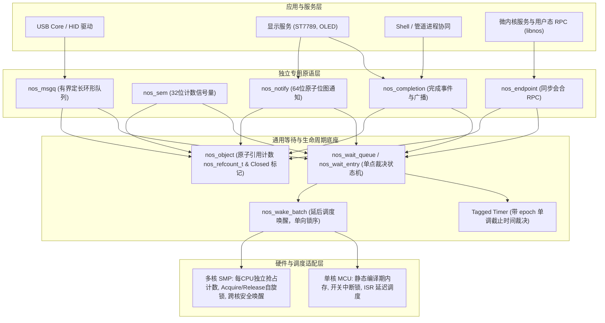
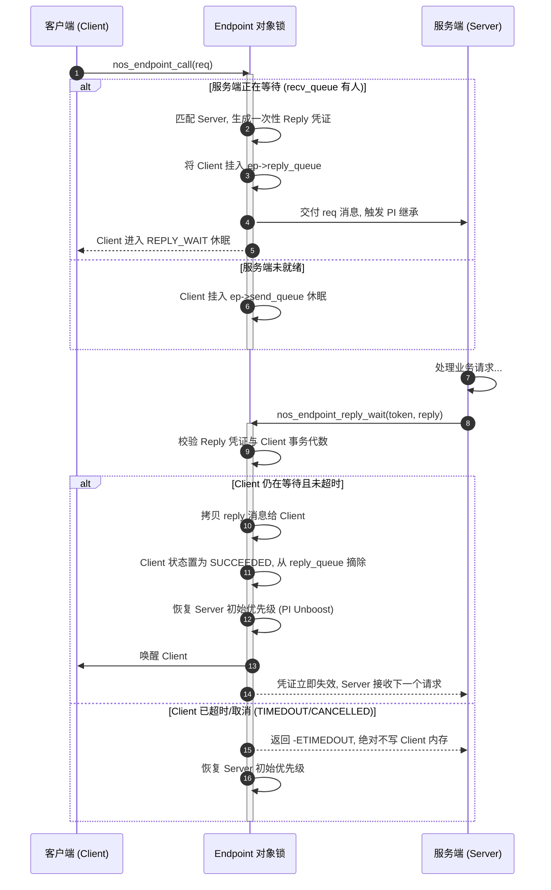
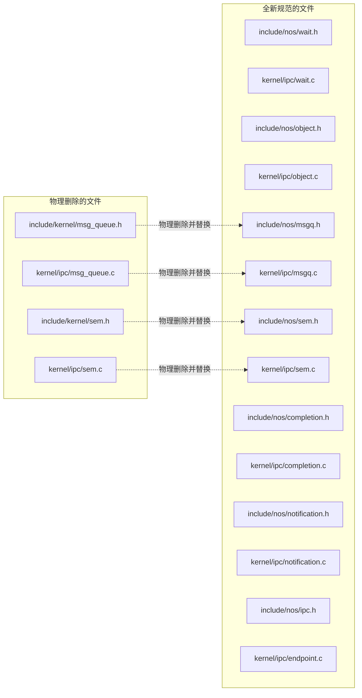

# NOS 消息队列、信号量与 IPC 全新架构设计规范

- **文档日期**：2026-11-04
- **目标分支**：`redesign_ipc_nos_modules`
- **设计状态**：已由用户确认方案 1（Linux/Zephyr 混合架构：通用等待与生命周期底座 + 职责分离的原语层）
- **适用平台**：资源受限单核 MCU (Cortex-M3/M4, RV32) 及 缓存一致性多核 SMP CPU (ARM64, RV64, x86_64)
- **兼容性原则**：彻底废弃与物理删除历史有缺陷的旧实现，全仓库直接迁移至现代新 API

---

## 1. 背景与重设计动因

对 NOS 代码库原有的 `kernel/ipc/msg_queue.c`、`kernel/ipc/sem.c`、`kernel/ipc/endpoint.c`、`kernel/ipc/notification.c` 审查发现，现有实现存在严重的设计缺陷与并发数据竞争：

1. **消息队列 (`msg_queue`) 缺陷**：
   - **动态内存与性能抖动**：每次 `msg_q_send` 均无条件调用 `kmalloc(GFP_KERNEL)` 分配堆内存，队列无上限，在 MCU 上易造成内存碎片与耗尽风险，且无法在中断服务程序（ISR）中安全调用；
   - **单消费者限制**：强制绑定单接收任务（`owner`），不支持 MPMC（多生产者多消费者）；
   - **生命周期缺失**：`msg_q_remove()` 为空实现，未消费消息内存直接泄漏，阻塞等待的任务无法被唤醒。
2. **信号量 (`sem`) 缺陷**：
   - **8 位计数与静默饱和**：`sem->count` 为 `uint8_t`，超过 255 静默饱和；`sem_get` 无返回值，无法执行 `trywait` 或处理错误；
   - **超时解绑致命 Bug**：`sem_get_timeout` 超时后未将任务从 `wait_list` 移除，后续 `sem_send` 访问已失效节点会直接引发链表损坏或触发 `BUG_ON`；
   - **广播语义滥用破坏守恒**：`sem_send_all` 唤醒所有任务但不提供对应数量的 token，破坏了计数信号量的守恒不变量；
   - **中断中非法调度**：`sem_send` 无条件调用 `switch_task()`，在中断上下文中调用会破坏中断栈和调度器状态；
   - **临时链表复用导致双重唤醒**：唤醒路径将 `task->list` 挂入临时唤醒链表并释放对象锁，此时若定时器超时在另一核触发，会并发将该任务入就绪队列，导致调度状态严重损坏。
3. **微内核 IPC (`endpoint` / `notification`) 缺陷**：
   - **在途回复等待丢失与死锁**：客户端发起调用后进入 `REPLY_WAIT` 并脱离发送队列，`nos_endpoint_close` 仅遍历发送/接收队列，彻底遗漏回复等待方，导致客户端永久死锁；
   - **回复无锁裸写与 UAF**：服务端 `nos_endpoint_reply_wait` 在无锁状态下读写客户端任务的 `ipc_state`、`ipc_partner` 和 `ipc_msg`；若客户端超时返回，服务端仍持有裸指针写入，构成典型的 Use-After-Free；
   - **Capability 裸指针与并发销毁**：查找 Capability 直接返回裸指针未固定生命周期，并发 `destroy` 立即 `kfree`，导致并发调用方访问已释放内存。
4. **多核调度竞争**：
   - 调度禁止嵌套计数 `scheduler_lock_nest` 为全局共享变量，多核同时加减存在严重的数据竞争与状态踩踏。

---

## 2. 总体分层架构

全新架构借鉴 **Linux 的等待队列与引用生命周期模型** 以及 **Zephyr / FreeRTOS 的静态零堆与确定性时延策略**，分为三个严格解耦的层次：



---

## 3. 通用等待底座与生命周期机制

### 3.1 等待记录 (`struct nos_wait_entry`)
每个任务结构体 `struct task_struct` 内部内嵌一个专用的等待记录结构，彻底杜绝字段复用冲突：
```c
enum nos_wait_state {
    NOS_WAIT_STATE_IDLE = 0,
    NOS_WAIT_STATE_WAITING,
    NOS_WAIT_STATE_SUCCEEDED,
    NOS_WAIT_STATE_TIMEDOUT,
    NOS_WAIT_STATE_CLOSED,
    NOS_WAIT_STATE_CANCELLED,
};

struct nos_wait_entry {
    struct list_head    wait_node;     /* 挂入等待对象的队列 */
    struct list_head    wake_node;     /* 延后唤醒批次链表节点 */
    uint64_t            epoch;         /* 严格递增的等待代数 */
    uint8_t             state;         /* enum nos_wait_state */
    int32_t             result;        /* 最终完成返回值 */
    uint64_t            deadline;      /* 绝对单调截止时间戳 (ticks) */
    struct nos_object  *waiting_obj;   /* 当前等待的对象引用 */
};
```

### 3.2 对象生命周期头 (`struct nos_object`)
所有 IPC 原语结构体的首部均必须内嵌 `struct nos_object`：
```c
typedef struct nos_refcount {
    atomic_t ref;
} nos_refcount_t;

struct nos_object {
    spinlock_t          lock;          /* 保护对象所有内部状态、队列与状态迁移 */
    nos_refcount_t      refcount;      /* 原子引用计数 */
    bool                closed;        /* 是否已被关闭 */
    bool                is_static;     /* 是否为静态声明内存 (不执行 kfree) */
};
```

### 3.3 严格锁序与单点线性化裁决规则
1. **全局加锁顺序**：
   $$\text{任务锁 } (task\to lock) \longrightarrow \text{对象锁 } (object\to lock) \longrightarrow \text{叶子调度锁 (runqueue)}$$
   - 严禁在持有 `object->lock` 时反向获取 `task->lock`。
2. **单一线性化裁决点（Single Linearization Point）**：
   - 等待状态的终态（`SUCCEEDED`、`TIMEDOUT`、`CLOSED`、`CANCELLED`）**必须且只能在持有 `object->lock` 的临界区内一次性提交**；
   - 资源交付与状态变更（如获取令牌、出入队列、写入消息）与 `state = SUCCEEDED` 在同一临界区原子完成；
   - 超时定时器触发时，必须先获取 `object->lock`，校验任务仍处于 `WAITING` 且代数匹配，才能置为 `TIMEDOUT`；若对象已先一步交付资源，定时器作为 no-op 放弃。
3. **延后唤醒批次（Deferred Wakeup Batch）**：
   - 在 `object->lock` 内，将完成状态裁决的任务从等待队列移除，加入局部的 `struct nos_wake_batch`；
   - 释放 `object->lock`；
   - 遍历 `wake_batch`，此时获取各个任务的 `task->lock`，更新调度状态并加入就绪队列。若处于中断上下文，仅置位调度标志（如 Cortex-M 的 PendSV），**严禁在中断中调用 `switch_task()`**。

### 3.4 Tagged Timer 与单调时钟
- 统一采用系统单调时钟计算绝对时间 `deadline = current_tick + timeout`；
- 定时器入队时携带不可变的 `(task, epoch)` 标签，即使定时器回调因多核延迟触发，若其 `epoch` 小于任务当前的代数，直接安全丢弃，不发生误唤醒。

---

## 4. 本地同步与通信原语详细设计

### 4.1 有界定长消息队列 (`nos_msgq`)
专为替代老旧的无界动态堆分配消息队列，具备完全确定的时延与内存占用。

#### 数据结构
```c
struct nos_msgq {
    struct nos_object   object;
    uint8_t            *buffer;        /* 调用方传入的静态环形缓冲 */
    size_t              element_size;  /* 单条消息的定长字节数 */
    uint32_t            capacity;      /* 队列最大容量条数 */
    uint32_t            head;          /* 读索引 */
    uint32_t            tail;          /* 写索引 */
    uint32_t            count;         /* 当前排队的消息数 */
    struct list_head    wait_send;     /* 发送者等待队列 (队列满时排队) */
    struct list_head    wait_recv;     /* 接收者等待队列 (队列空时排队) */
};
```

#### 核心操作契约
- `int nos_msgq_init(struct nos_msgq *q, void *buffer, size_t buffer_bytes, size_t element_size, uint32_t capacity)`:
  - 校验 `buffer_bytes >= element_size * capacity`，防算术溢出；
  - 初始化对象自旋锁与等待队列，标记为静态存储。
- `int nos_msgq_send(struct nos_msgq *q, const void *element, size_t size, nos_timeout_t timeout)`:
  - 校验 `size == q->element_size`（不匹配返回 `-EINVAL`）；
  - 若队列未满：直接将数据复制进环形缓冲，更新索引与计数；若 `wait_recv` 有等待者，挑选最高优先级任务挂入唤醒批次；
  - 若队列已满：
    - 中断上下文（ISR）或 `timeout == NOS_NO_WAIT`：直接返回 `-ENOSPC` 或 `-EAGAIN`，绝不休眠；
    - 任务上下文：将当前任务挂入 `wait_send` 阻塞等待空间释放，超时返回 `-ETIMEDOUT`。
- `int nos_msgq_recv(struct nos_msgq *q, void *element, size_t size, nos_timeout_t timeout)`:
  - 校验 `size >= q->element_size`（缓冲区不足返回 `-EMSGSIZE`，不截断数据）；
  - 若队列有数据：直接从环形缓冲拷贝出一条消息，更新索引；若 `wait_send` 有等待者，挑选最高优先级发送任务挂入唤醒批次；
  - 若队列为空：非阻塞或 ISR 返回 `-EAGAIN`；任务上下文挂入 `wait_recv` 阻塞等待。
- `int nos_msgq_close(struct nos_msgq *q)`:
  - 标记 `closed = true`，唤醒所有等待发送和等待接收的任务，返回值置为 `-EPIPE`。
- **内存保证**：发送和接收运行时热路径**绝对零堆分配（Zero Heap Allocation）**。

---

### 4.2 32 位计数信号量 (`nos_sem`)
严守资源守恒与令牌计数的纯粹原语，不处理所有者优先级继承（互斥由 `mutex` 承接）。

#### 数据结构
```c
struct nos_sem {
    struct nos_object   object;
    uint32_t            count;         /* 当前可用资源令牌数 */
    uint32_t            limit;         /* 最大允许的令牌上限 */
    struct list_head    wait_queue;    /* 按实时优先级排队的等待链表 */
};
```

#### 核心操作契约
- `int nos_sem_init(struct nos_sem *sem, uint32_t initial, uint32_t limit)`:
  - 校验 `initial <= limit` 且 `limit > 0`，否则返回 `-EINVAL`。
- `int nos_sem_take(struct nos_sem *sem, nos_timeout_t timeout)`:
  - 若 `count > 0`：`count--`，成功返回 `0`；
  - 若 `count == 0`：非阻塞或 ISR 返回 `-EAGAIN`；任务挂入 `wait_queue` 休眠等待；超时返回 `-ETIMEDOUT`，关闭返回 `-EPIPE`。
- `int nos_sem_trytake(struct nos_sem *sem)`:
  - 非阻塞快捷获取（等价于 `nos_sem_take(sem, NOS_NO_WAIT)`）。
- `int nos_sem_give(struct nos_sem *sem)`:
  - 若有任务在 `wait_queue` 中等待：直接将令牌交接给最高优先级的等待任务，从队列摘出并加入唤醒批次，`count` 不变；
  - 若无等待任务：检查 `count < limit`，成立则 `count++`，若已达上限则返回 `-EOVERFLOW`（拒绝静默饱和溢出）；
  - 允许在 ISR 中安全调用。
- `int nos_sem_close(struct nos_sem *sem)`:
  - 标记关闭并唤醒所有等待任务返回 `-EPIPE`。

---

### 4.3 完成量 (`nos_completion`)
用于单次操作完成与广播任务同步，彻底取代原旧代码滥用 `sem_send_all()` 的错误行为。

#### 数据结构
```c
struct nos_completion {
    struct nos_object   object;
    uint32_t            done;          /* 0: 未完成; >0: 单次完成计数; UINT32_MAX: 广播完成 */
    struct list_head    wait_queue;    /* 等待完成的任务队列 */
};
```

#### 核心操作契约
- `int nos_completion_init(struct nos_completion *comp)`:
  - 初始化完成量，`done = 0`。
- `int nos_completion_wait(struct nos_completion *comp, nos_timeout_t timeout)`:
  - 若 `done == UINT32_MAX`（已广播）：直接成功返回 `0`；
  - 若 `done > 0`：`done--`，成功返回 `0`；
  - 若 `done == 0`：非阻塞返回 `-EAGAIN`；任务挂入 `wait_queue` 休眠等待。
- `int nos_complete(struct nos_completion *comp)`:
  - 单次触发：若有等待者，唤醒最高优先级的一个任务；若无等待者，`done++`。
- `int nos_complete_all(struct nos_completion *comp)`:
  - **广播唤醒**：将 `done` 置为 `UINT32_MAX`，唤醒 `wait_queue` 中的所有等待者；此后所有进入 `nos_completion_wait` 的任务无需阻塞直接通过。专用于线程 join、退出清理和关机同步。
- `int nos_completion_reset(struct nos_completion *comp)`:
  - 仅在 `wait_queue` 为空时允许重置 `done = 0`，否则返回 `-EBUSY`。

---

### 4.4 64 位异步位图通知 (`nos_notify`)
专用于硬件外设中断向工作线程发送异步事件标志，支持高频同位合并。

#### 数据结构
```c
struct nos_notification {
    struct nos_object   object;
    uint64_t            pending_bits;  /* 累积未处理的位图事件 */
    struct list_head    wait_queue;    /* 消费者等待队列 (通常为单个任务) */
};
```

#### 核心操作契约
- `int nos_notification_init(struct nos_notification *notif)`:
  - 初始化通知对象，`pending_bits = 0`。
- `int nos_notify_signal_obj(struct nos_notification *notif, uint64_t bits)`:
  - `pending_bits |= bits`（位图累加，天然去抖与流速匹配）；
  - 若有等待任务，交付 `pending_bits`，清零内部位图，将等待者加入唤醒批次；ISR 安全。
- `int nos_notify_wait_obj(struct nos_notification *notif, uint64_t *out_bits, nos_timeout_t timeout)`:
  - 若 `pending_bits != 0`：原子读出并清零内部位图，返回 `0`；
  - 若 `pending_bits == 0`：挂入等待队列阻塞，超时返回 `-ETIMEDOUT`。

---

## 5. 微内核同步 Endpoint IPC 详细设计

### 5.1 固定 64 字节 UAPI 规范
严格保持 `include/uapi/nos/ipc.h` 中 `struct nos_ipc_msg` 为 **64 字节** 不变：
```c
struct nos_ipc_msg {
    uint32_t tag;                      /* 操作码、传输标志与 Capability 数量 */
    uint32_t token;                    /* 身份 Token 或防伪造 Badge */
    int32_t  status;                   /* 响应状态码 */
    uint32_t data[7];                  /* 寄存器快速通道数据 (28 字节) */
    nos_handle_t caps[NOS_IPC_MAX_CAPS];/* 随消息附带传递的句柄 */
    uint64_t buf_addr;                 /* 大数据共享内存地址 */
    uint32_t buf_size;                 /* 大数据大小 */
};
_Static_assert(sizeof(struct nos_ipc_msg) == 64, "nos_ipc_msg ABI size must be 64 bytes");
```

### 5.2 在途 RPC 事务与一次性安全 Reply 机制
为彻底解决旧实现中客户端在 `REPLY_WAIT` 时脱离队列、关闭失联死锁以及服务端无锁写导致 UAF 的问题，引入 **在途事务（In-flight Transaction）管理**：

```c
struct nos_endpoint {
    struct nos_object   object;
    uint32_t            id;
    struct list_head    send_queue;    /* 等待投递请求的客户端队列 */
    struct list_head    recv_queue;    /* 等待接收请求的服务端队列 */
    struct list_head    reply_queue;   /* 正在等待回复的在途客户端事务队列 */
};
```

#### 核心事务流程


- **关闭安全性**：当 `nos_endpoint_close()` 执行时，在 `ep->lock` 保护下**同时遍历 `send_queue`、`recv_queue` 和 `reply_queue`**，所有等待回复的客户端统一收到 `-EPIPE` 唤醒并安全退出，彻底清除悬挂死锁。

### 5.3 Capability 查找与对象引用固定 (Pinned Lookup)
- 在系统调用入口通过 `nos_cap_lookup` 查找对象时，必须在 Capability 表锁内**同步递增对象的原子引用计数**：
  ```c
  nos_refcount_get(&obj->refcount);
  ```
- 系统调用退出时调用 `nos_refcount_put(&obj->refcount)`；
- `nos_endpoint_destroy()` 仅置 `closed = true` 并唤醒队列，物理内存直至最后一个在途系统调用退出、引用归零时才真正释放，彻底规避并发 Use-After-Free。

---

## 6. 多核 SMP 与 MCU 双向兼容设计

### 6.1 MCU 资源确定性保证
- **零堆分配**：所有原语均采用静态初始化接口，支持 C99 编译期全局静态分配；
- **单核快速路径**：在单核编译配置下，`spinlock` 直接映射为关本地中断，消除多核缓存一致性开销；
- **中断延迟调度契约**：ISR 中只执行无等待原语操作（`NOS_NO_WAIT`），唤醒时仅置位调度器标志（如 ARM Cortex-M 的 `ICSR.PENDSVSET`），中断退出时再执行物理任务切换，保护中断栈不被破坏。

### 6.2 多核 SMP 并发安全保证
- **每 CPU 独立抢占计数**：
  彻底废弃旧的全局 `scheduler_lock_nest` 变量，使用 `per_cpu` 存储：
  ```c
  DECLARE_PER_CPU(uint32_t, scheduler_lock_nest);
  ```
  每个 CPU 核心只修改本核的抢占嵌套深度，杜绝跨核数据踩踏。
- **内存屏障与锁规范**：
  所有自旋锁操作具备标准的 Acquire / Release 内存屏障语义；跨核唤醒通过核间调度接口进行，避免在持对象锁时请求远端核。

---

## 7. 错误码与 API 规范

### 7.1 Timeout 契约
- `NOS_NO_WAIT = 0U`
- `NOS_WAIT_FOREVER = UINT32_MAX`
- `1 .. UINT32_MAX - 1`：相对时钟 ticks（内核入口转换为单调绝对 deadline）。

### 7.2 返回值速查表
| 错误码 | 含义说明 | 典型触发场景 |
| :--- | :--- | :--- |
| `0` | 操作成功 | 正常获取资源、消息发送/接收成功 |
| `-EINVAL` | 无效参数 | 空指针、容量乘法溢出、尺寸不匹配 |
| `-EAGAIN` | 非阻塞暂无资源 | 非阻塞 take 信号量为空、非阻塞读空队列/写满队列 |
| `-ETIMEDOUT` | 操作超时 | 指定时间到期仍未获取到资源或响应 |
| `-EPIPE` | 对象关闭或对端断开 | 正在等待的对象被并发 `close`，或 RPC 服务端崩溃退出 |
| `-ECANCELED`| 操作被取消 | 任务被终止或强制撤销当前等待 |
| `-ENOSPC` | 存储空间耗尽 | ISR 发送消息时队列已满 |
| `-EOVERFLOW`| 数值或计数溢出 | 信号量超过 limit 上限，或等待代数耗尽 |
| `-EMSGSIZE` | 消息尺寸不匹配 | 接收缓冲区小于消息固定尺寸 |
| `-EBUSY` | 状态繁忙 | 任务试图发起重入等待，或在有等待者时重置 completion |

---

## 8. 历史代码物理删除与全仓库迁移计划

根据“不用考虑历史兼容，该删的就删，该改造的就改造”的指导原则，本规范要求**直接物理删除旧代码文件，并将仓库所有调用方直接重构迁移至新接口**：



### 仓库内现有调用方直接改造清单

1. **USB 设备驱动与类库 (`drivers/usb/device/`)**：
   - `core/core.c`：将旧 `struct msg_queue usb_mq` 改造为 `struct nos_msgq`，使用静态分配的事件 buffer，发送时在中断中使用 `NOS_NO_WAIT`；
   - `class/hid.c`：将 `struct msg_queue hid_mq` 改造为 `struct nos_msgq`；
   - `class/cdc.c`、`class/winusb.c`：将传输等待的 `sem_t` 改造为 `struct nos_completion`。
2. **显示服务与驱动 (`drivers/display/`, `app/server/display/`, `app/display/`)**：
   - 屏幕刷新等待（ST7789、SSD1106 等）由 `sem_t` 改造为 `struct nos_completion`；
   - 帧同步或按键事件由 `sem_t` 改造为 `struct nos_notify`。
3. **命令行与管道 (`app/shell/nshell.c`, `app/shell/pipe.h`)**：
   - 移除 `sem_send_all()` 唤醒子任务，使用 `nos_completion_wait()` 与 `nos_complete_all()` 广播退出。
4. **文件系统同步 (`fs/fatfs/sync.c`, `fs/vfs_io.c`)**：
   - 移除使用信号量进行文件互斥的错误用法，统一使用带优先级继承的 `struct mutex`。
5. **硬件板级与测试程序 (`board/nk60-v2/led.c`, `app/tests/`)**：
   - LED 状态更新迁移至 `struct nos_notify`；
   - `app/tests/test.c`、`fatfs_test.c` 等测试用例中的旧信号量/消息队列 API 替换为新原语验证。
