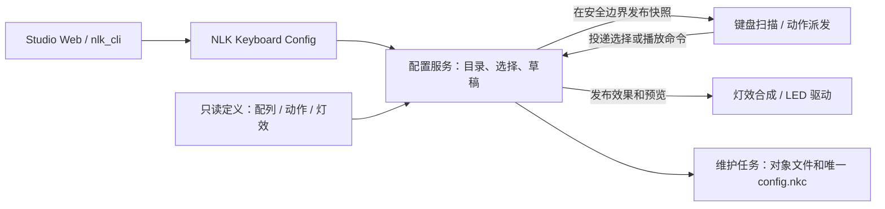

# NK60 配置系统与 NLK Keyboard Config 设计

状态：已批准的设计记录。已纳入单配列和不做旧版本兼容的约束。适用：NOS 的 NK60-V1/V2、独立 C++ `nlk_cli`、Studio Web 和 Studio 的 Rust/Tauri 客户端。实现后，以本文替代旧《NK60 Configuration Design》中关于编辑、选择和持久化的约定；不改变 NLK 升级模式和其他 capability 的帧格式。

## 1. 现状、参考与选型

- 现有基础、灯效、宏文件已经分目录，但 `active.nkc` 仍保存整份运行态，普通 setter 会引发后台写入；基础文件可能内联宏。指定配置/宏的目标还塞在 32 位键值的 24 位哈希里，灯效 ID 依赖注册顺序。
- V1/V2 把共同的配列、动作、效果定义放在各自板目录。Web 固定使用 `NK60_PHYSICAL_LAYOUT` 和自建效果预览表，直接调用旧 `SET_*`。C++ 和 Rust 两套 CLI 也分别编码旧协议。
- QMK 在键盘或用户 keymap 的构建配置中启用自定义灯效，通过 `RGB_MATRIX_EFFECT` 声明效果并编入渲染分发。效果可按本次处理的 LED 范围渲染，也可在进入效果时初始化状态。QMK 为切换模式、颜色、速度和开关提供 `_noeeprom` API。它们修改共享的当前设置，本次调用不标记待写。按当前实现，如果这份共享配置此前已被标记待写，随后 flush 仍会保存当时的整个结构体。NK60 由配置服务维护独立的灯效预览快照，使待写的实体键选择与预览互不串写。[QMK 自定义灯效](https://docs.qmk.fm/features/rgb_matrix#custom-rgb-matrix-effects) · [渲染与 RGB 设置实现](https://github.com/qmk/qmk_firmware/blob/master/quantum/rgb_matrix/rgb_matrix.c) · [EEPROM 写入实现](https://github.com/qmk/qmk_firmware/blob/master/quantum/eeconfig.h)
- VIA Custom UI 用字段 ID 描述通用控件，把读取、修改和保存分成不同命令。官方描述的 VIA 客户端在修改后短延时自动发 Save。NK60 由固件提供类型和约束，Web 只在用户确认覆盖或另存时发 COMMIT。[VIA Custom UI](https://caniusevia.com/docs/custom_ui/#saving-values)
- [ZMK 物理配列](https://zmk.dev/docs/hardware-integration/physical-layouts) 将矩阵映射与键帽几何放入配列定义；[ZMK 行为模块](https://zmk.dev/docs/development/new-behavior) 同时提供执行行为和参数元数据；[ZMK 灯效快捷键](https://zmk.dev/docs/keymaps/behaviors/underglow) 对持久化做延迟合并。NK60 分别采用配列描述、行为参数描述和延迟写入。
- Wooting 可用实体键循环或直达板载整套配置，适合快速切换使用场景。NK60 让基础和灯效独立选择，适合跨键位复用灯效。若将来需要游戏、办公等一键场景，可给两个引用组合命名，共用同一个提交点和宏库。[Wooting 60HE 快速指南](https://wooting.io/quickstart/keyboard/wooting-60he/prebuilt) · [Wooting 80HE 快速指南](https://wooting.io/quickstart/keyboard/wooting-80he/prebuilt)
- 推荐统一键盘 capability、类型化字段与显式草稿事务。NLK 复用帧、路由和发现，JSON 用于宿主编辑及导入导出。存储先验证现有双板的空间预算。单个对象文件和根文件分别原子改名是更小的实现，掉电可能留下已经可见、尚未激活的新预设。本文选用精简目录清单，因为它让「保存并启用」在任何掉电点只呈现一次完整提交。保留当前生效目录、其引用的对象及读者固定的版本。暂存版本只活到提交或失败清理，过期 revision 在无读者时回收。

## 2. 数据模型和权威来源

| 层 | 内容 | 权威来源 |
| --- | --- | --- |
| 注册定义 | 本构建的唯一配列（几何、触发能力、扫描和灯位映射）、动作与参数、灯效与参数 | 固件的只读定义 |
| 基础配置 | 绑定的配列 ID/版本、层与默认层、每层的键位/动作映射、触发及配列参数 | `/data/keyboard/base/<id>/<rev>.nkc` |
| 灯效配置 | 主灯效 ID/参数、可选的灯区和图层合成配置；每个图层可引用自己的效果及参数、激活动作及区域 | `/data/keyboard/light/<id>/<rev>.nkc` |
| 宏配置 | 一个独立宏的名称及有序步骤：按下、释放、等待；绑定保存完整宏 ID | `/data/keyboard/macro/<id>/<rev>.nkc` |
| 聚合配置 | 当前基础引用、当前灯效预设引用、总开关、目录 revision、根记录序号。灯效 ID 由当前预设解析，NLK STATE 同时返回两者 | **唯一正式文件 `/data/keyboard/config.nkc`** |
| 草稿 | 源对象及版本、未保存字段、预览状态 | 有界 RAM 会话；可取消或超时 |
| 瞬态 | Fn/PN 按住状态、HID 报告、指示灯信号、宏播放游标和灯效动画相位 | RAM，跟随输入或时钟 |

`<id>` 是大小写敏感的 1–23 字节可移植 ASCII 标识（字母、数字、下划线、连字符），可以重命名显示名称而不改变 ID；`<rev>` 是固定 16 位十六进制 revision 的文件名。引用用 `(kind, id)`，激活记录进一步绑定精确 revision；对象 ID、定义 ID、revision 均不依赖数组位置、注册顺序或短哈希。版本文件及目录路径是实现细节。使用短目录和短文件名是因为 NOS VFS 对单个路径分量限制为 31 字节。

首次初始化把默认基础及默认灯效预设写入文件系统，保存为各自类型的 `default`，可正常覆盖或另存。配列和灯效定义仍提供只读出厂值，用于恢复、没有某效果预设时预览与切换。出厂值用 revision 0、保留 ID `~<定义 ID>` 表示；用户 ID 不允许 `~`。对这类虚拟灯效选择执行「覆盖当前」时，显式保存会创建一个正常的固定 ID 预设（优先用效果 ID，遇同名则让用户指定未占用 ID），并将其设为当前选择；固件出厂模板仍可用于恢复。可写配置一律落在文件系统。灯效文件表示一套参数预设，`light_enabled` 只在 `config.nkc`；预设中的图层开关是配方的一部分。灯效切换只改变当前灯效选择，关灯时切换仍保持关灯。首版关灯控制背光合成；Caps Lock 等板级状态指示照常工作，配置里通过动作定制的非指示灯覆盖随背光关闭。

基础配置用配列定义给出的稳定 `key_id`。每个绑定保存一个 `action_id` 及其类型化参数。键位的动作列表按绑定顺序保留，动作参数与 HID usage 分开。开关类型与触发字段由配列和板能力联合限定。NK60 首期公开机械消抖、扫描参数及已实现的动作触发。配置里的配列 ID/版本用于加载校验，编辑器将其显示为只读。加载或导入不同配列的文件会返回错误。更换配列需要选择对应 Kconfig 选项并重新构建、刷入固件。

| 注册动作 | `target` 参数类型 | 绑定实例 |
| --- | --- | --- |
| `config_select` | 必填 `object_ref<base>` | `config_select{target="office"}`、`config_select{target="game"}` |
| `macro_play` | 必填 `object_ref<macro>` | `macro_play{target="build"}`、`macro_play{target="format"}` |

两种动作各注册一次，各有一个实现文件。NLK 动作列表每种只返回一条描述。Web 的目标下拉框和 CLI 的 `--target` 由参数所声明的对象类型决定，预设和宏从各自的对象列表读取。绑定保存完整逻辑 ID，执行前解析到当前已提交版本。因此覆盖同 ID 的宏或预设会更新所有引用它的绑定，另存出的新 ID 可以独立绑定。固件在提交时验证类型与目标存在性，在执行时复验目标。

宏由已存对象提供，可独立创建、编辑、加载和播放。播放开始时由 worker 校验、加载并固定该 revision 到有界播放缓存，扫描路径只消费已准备的步骤；拒绝相互递归调用、超长总时长及超容量步数。完成、取消或切换基础配置时，释放该宏持有的所有键位和修饰键。宏播放不改变 `config.nkc` 中的选择；显式保存宏只通过目录 revision 进入事务。删除活动基础/活动灯效，或被任一已保存基础引用的基础/宏时返回 `BUSY` 和首个引用来源；用户可以先更换选择或解绑。未保存草稿引用的对象被删除后，草稿仍可读，但提交需重新验证引用。

## 3. 固件边界与扩展方式

- `app/server/keyboard/` 将设备输入、配置服务、编解码/存储和注册表分开。沿用现有维护任务执行有界的存储/校验队列；扫描和灯效帧内不读写 VFS，不做解码，不等待维护任务。配置服务持有工作态，NLK 适配器只将校验过的请求转成服务调用。切换基础配置先准备新快照，再在扫描边界释放原 HID/媒体键和动作状态，等待原本按住的物理键松开后再接受新按下。驱动参数变更也在这个边界应用。效果参数快照在帧边界换入。
- 每个配列用一个文件，如共享的 `layouts/nk60_ansi61.c`，定义 `layout_id`、硬件兼容范围、默认层/键位、键帽的 `x/y/w/h` 与可选旋转（1/100 键位单位）、稳定键位和矩阵/LED 映射、触发参数描述。V1/V2 的硬件差异由 BSP 映射注入，共用的几何及默认值只维护一份。Kconfig 的 `choice` 只暴露当前板支持的选项（如 `CONFIG_KEYBOARD_LAYOUT_NK60_ANSI61`）；CMake 只编入被选中的那个文件，构建检查必须恰好有一个。运行时只有该描述符，没有配列列表的可选项、配列 setter 或多配列副本。
- 每个动作用一个文件，如 `actions/config_select.c`、`actions/macro_play.c`、`actions/key_chord.c`。文件提供稳定 `action_id`、支持的事件、参数描述、可选校验/编译回调、press/release/cancel。会改变选择的动作仅向配置服务投递命令；回调不能直接改目录、写文件或改变持久化状态。沿用动作链的 pass/consume 及正确释放规则；动作型快捷键只在 press 沿执行，不因按住自动重复。
- 每个效果用一个文件，如 `effects/rainbow.c`、`effects/wave.c`。文件提供稳定 `effect_id`、循环顺序、适用灯区、参数定义及默认值、可选校验与渲染回调。只使用现有字段类型的新效果可直接通过 NLK 暴露给通用客户端。
- 由组件 CMake 清单编入独立 C 文件，板级显式选择支持集合；新增一种定义需要一个实现文件和一条构建/装配登记，不改 RPC、配置文件编解码器、Web 外壳或扫描主循环。启动/主机测试检查同类型 ID 与字段 ID 不重复、默认值及依赖有效。禁止把 C 函数指针、结构体填充、可移动注册序号等写入文件或 NLK。

注册定义版本与文件格式版本独立。注册定义的字段使用 `u16 field_id`，包括类型、默认值、必填、范围、步长、单位、枚举、标签/帮助及可选控件提示。首版字段类型为 bool、有符号/无符号整数、enum、RGB、HID usage、对象/定义引用、有限长度 UTF-8/bytes；几何、映射、图层及宏步骤作为有类型的集合，使用有界元素数。使用现有字段类型即可新增可被通用客户端编辑的定义。字段 ID、定义版本用于精确定位和校验，不提供旧 schema 翻译、按旧字段降级或跨版本迁移。新字段类型须和固件、客户端一起发布；不支持的格式明确报错。固件负责最终校验、边界和跨字段/跨对象约束。

### 灯效注册、实例和渲染

同一个效果定义可供多个预设和图层复用。预设保存效果 ID、参数值和图层编排。每个活跃图层及预览有独立的效果实例。合成器在实例创建时提供有界的 RAM 状态空间，并调用可选的 `init`。例如，同一个波纹效果可以在底层用蓝色慢速播放，在上层用白色快速响应按键。常亮效果只需颜色，彩虹可声明速度和方向，按键波纹可声明颜色、传播速度和衰减时间。

每帧的渲染输入包含单调时间、帧间隔和当前图层的灯区与 LED 坐标。需要按键响应的效果另外读取有界的近期按键事件快照，事件含稳定键位 ID、按下或释放及时间戳。效果输出该图层的 RGB 像素。合成器统一处理掩码、透明度、叠加顺序、指示灯优先级、背光开关和整机亮度上限，再交给板级 LED 驱动。效果回调只操作本实例状态与输出，实例和帧预算在配置生效前校验。以 NK60 实机的帧耗时与键扫延迟决定是否需要像 QMK 一样分段渲染。

设备预览和正常播放使用同一批效果实现及合成规则。启用设备预览时，从草稿发布独立的参数快照和实例。退出时恢复当前活动预设。自动落盘读取活动选择，显式保存才读取用户确认的草稿。验收增加一个并发用例，在已有待写的开关或切换操作时持续拖动预览滑块，重启后确认只恢复原先的快捷键选择。

## 4. 选择、编辑和保存

| 操作 | 设备行为 | 存储 |
| --- | --- | --- |
| `light_next` / `light_prev` | 按 `(cycle_order, effect_id)` 循环本板可用主效果，关灯不作为循环中的一个效果。目标优先取该效果最新显式保存的兼容预设，其次出厂参数；总开关保持不变 | 只标记根记录待写 |
| `config_next` / `config_prev` | 在 `default` 和其他可加载基础预设之间按大小写敏感 ID 顺序循环，`default` 排首位；失败保持当前基础，单项无变化 | 只标记根记录待写 |
| `config_select{target}`、NLK 激活指定基础/灯效 | 按完整 ID 准备目标，校验兼容性后生效 | 只标记根记录待写 |
| `light_toggle` | 更新总开关。NLK 对应指令传绝对值，避免重试时误切两次 | 只标记根记录待写 |
| `macro_play{target}` | 播放一个已保存宏 | 不写 |
| BEGIN/PATCH/PREVIEW/ABORT | 创建/修改/预览/取消设备草稿 | 不写文件，不修改根记录 |
| COMMIT overwrite/create | 覆盖当前对象的逻辑 ID，或创建新 ID；基础/灯效保存成功即激活刚写的新 revision；宏覆写的是当前编辑的已保存宏，没有「活动宏」 | 单次显式事务，成功响应要等落盘 |
| DELETE | 校验引用，更新目录视图 | 单次显式事务，成功响应要等落盘 |

一次仅提供一个设备编辑租约（可编辑 base、light 或 macro 中一种），空闲 60 秒过期；连接仍在时由 Web/CLI 心跳续租。开始编辑加载当前生效对象，也可从另一个已保存对象起草另存。基础键位和动作在 Web 先通过键位视图与测试面板检查；首版保存前保持设备原有打字行为。编辑器内的选择灯效类型、亮度和参数只走 PATCH；编辑器外的「启用已保存配置」是明确的 RUN 操作，同实体键切换一样会延迟落盘。灯效可在 Web 预览，也可以启用设备预览覆盖；预览遵循当前总开关，停止后恢复当下真实选择。预览只存在于 RAM，不启用宏或配置动作。断连、主动放弃、租约过期会释放草稿和预览；若显式保存已进入提交阶段，断连不撤销该次事务，重连后从设备状态核对结果。

同类的实体键或另一客户端选择仍能生效，撤掉该类预览并将原草稿标为冲突；草稿不会丢弃或被自动覆盖。提交检查源 revision、同类选择 epoch 及所选目标条件。总开关、另一类选择变化不挡提交，提交时合并最新的非冲突运行态。冲突后可重新加载，或由客户端读取原草稿，放弃旧租约，以最新 epoch 建新租约并显式重放修改、另存；不静默覆盖。切换操作与提交由同一队列排序，序号反映实际生效顺序。

Web 页面统一显示活动对象、草稿标记和保存状态。保存弹窗给出「覆盖当前配置 / 另存为新配置 / 继续编辑」；虚拟灯效首次覆盖时明确提示即将创建的预设 ID。切页、切设备、载入另一份配置、断开及桌面关闭/退出前，统一选择「保存 / 放弃 / 继续编辑」；浏览器页签关闭或刷新只使用浏览器支持的原生 `beforeunload` 提示，不能承诺拦截断电或进程被杀。失败或冲突保留可用草稿，重连需重新读当前 revision，允许用户把仍在页面内存的改动重新应用。Web 与 CLI 都只在设备报告持久成功后显示「已保存」。硬件切换已生效但未落盘时单独显示「等待写入」，不算编辑草稿。CLI 写入命令必须显式选 `--overwrite` 或 `--save-as ID`；可以先编辑本地 JSON，再一次上传校验并提交。

## 5. 唯一根记录、掉电一致性与磨损

`config.nkc` 是唯一发布点。目录索引 `/data/keyboard/_catalog/<rev>.nki` 是一个轻量、只读版本清单，由根记录指向；它只映射 `(kind, id) -> committed_rev` 和兼容/循环查询索引，没有当前选择、开关或配置正文。这样每次物理快捷键可只写一个很小的根记录，且列表不会暴露只写了一半的新对象。对象、索引和根记录都有独立 magic、版本、长度、CRC32 与显式小端编码。对象 revision/目录 revision 从提交序列分配；恢复时不可重用仍被引用的版本，也不可把同号未发布孤儿当有效版本。

保存/覆盖/删除是同一 worker 串行执行的事务，用户的显式提交优先于可延后的垃圾回收：

1. 在 RAM 中验证完整草稿，预检驱动参数和切换条件，准备在根发布后无需再读盘、解码或分配的运行快照；与当前语义相同的覆盖保留原对象 revision，只在选择/开关等根字段也有变化时写根。
2. 分配对象/目录 revision，写并同步新对象与新目录；成功关闭后才可引用。创建或覆盖不会原地改正文，删除只从新目录去掉引用。若新根未发布，旧目录对象继续可用。目录查找只看根指向的清单，不通过扫描目录选择最新 revision。
3. 编码合并最新非冲突运行态后的根记录。写同目录临时文件，用 `nos_fsync`、检查关闭结果后，以 LittleFS 同卷原子 rename **覆盖** `config.nkc`；覆盖失败不允许退回「删除旧目标再重命名」。
4. 根发布后交接运行快照、报告成功。下一轮或空闲时清除当前根/目录不引用的已知孤儿；仍被读取或播放快照固定的对象需等释放。空间不足时只可回收确认未引用的文件，重试一次；失败后保留旧配置和可用草稿。

掉电发生在第 3 步前，启动沿旧根加载旧版本；第 3 步成功后加载新目录和新对象。临时文件不参与启动选择。若存储错误使 rename 的结果不明，需重新读根并按版本核对后才发布结果；读不到权威根则进入存储错误状态，阻止后续持久写，不能向客户端报告成功。清理失败不影响已成功的保存。首期仅在 NK60 真实持久 LittleFS 数据卷启用耐掉电提交；不把 RAMFS 或未验证支持原子覆盖的挂载当作成功落盘。使用 [littlefs 的 sync/rename 契约](https://github.com/littlefs-project/littlefs#usage)，并在 NOS VFS、LittleFS 和 W25Q 磨损均衡链路上实测；现有代码在挂载遇到 `LFS_ERR_CORRUPT` 时会格式化，需要把此数据卷的「明确初始化」与「异常挂载」拆开，异常挂载不得静默清空用户文件。

本地和远端激活/开关走相同队列：立即更新运行态，空闲 **5 秒** 后自动写根，连续操作 **30 秒** 时也写一次当时最新选择；两次自动写至少间隔 5 秒。不变或切回最近已持久语义无需写；显式保存立即提交，并把已有待写的运行态合入同一次根更新。失败保留待写并按 5/15/60 秒退避，之后每 60 秒重试，报告存储错误；定时器只唤醒 worker。掉电可能丢失尚待写的选择，重启回到最近已持久状态。显式保存成功则必须能在重启后恢复。统计根提交次数、LittleFS/W25Q 编程和擦除次数及最大键扫延迟，用切换压力测量实际写放大，不按逻辑写入次数推算 Flash 寿命。

正常启动挂载卷后读取且验证唯一根，再加载所指对象和注册定义。首次启用新配置服务时以单次事务写默认对象、目录和根；初始化中断可以重跑，孤儿不算已发布对象。系统不读取或转换旧 `active.nkc` 和旧扁平格式文件，也不自动清除它们；仅根路径明确返回 `ENOENT` 才走首次初始化；读盘失败或根存在但损坏时进入内置默认和可诊断的恢复态，保留用户文件，不从孤儿猜测最新配置。某一激活引用缺失或因固件变更不兼容时，仅该项回退出厂值并报告原因，不悄悄删除文件或改写根。远程通用 VFS 不得写配置服务拥有的目录或通过 rename/remove 修改其祖先；需在解析后的路径和两端 rename 上处理。旧式手动上传改走配置 import；未管理的交换目录可存备份文件。数据卷格式化/升级接口仍由原系统维护路径负责，触发前必须排空或停掉该服务。

## 6. NLK Keyboard Config 1.0

只使用 `NLK_CAP_KEYBOARD = 0x0100`，capability 版本为 `0x20`。配置事务、运行控制、按键事件及灯效同步统一归属于该能力，配置 worker 不单独注册能力。硬件描述从 CORE GET_CAP_DESC 读取。客户端发现该版本后再发送新配置 opcode；不兼容旧键盘 RPC。Web 只提供一个键盘与灯光入口。

| Op | 请求 / 核心响应 |
| --- | --- |
| `01 INFO` | 返回 boot epoch、特性位、设备接收上限、定义表 generation、各类对象/草稿/批次/宏步数上限及租约 TTL |
| `02 STATE` | 返回状态 generation、根序号、目录 revision、base/light epoch、活动引用、灯效 ID/总开关、预览存在、CLEAN/PENDING/ERROR/READ_ONLY；不泄露其他连接的租约 |
| `03 LIST` | `resource, generation, cursor, max_bytes` → `generation, next_cursor, entries`；resource 为动作/效果/基础/灯效预设/宏；配列是单例，直接 READ；对虚拟出厂项返回只读标记 |
| `04 READ` | `resource, id, revision, section, offset, max_bytes` → `resolved_revision, total_len, offset, bytes`；覆盖定义元数据、几何/默认值、字段描述或对象内容；`LAYOUT` 为单例，用空 ID 读本构建的配列 |
| `05 EDIT_BEGIN` | `kind, source_ref, expected_scope_epoch` → `lease, draft_revision, deadline_ms`；同一命令也可从该 kind 的出厂模板起草 |
| `06 EDIT_PATCH` | `lease, expected_draft_revision, records[]` → 新草稿 revision；一批全成或全不成。支持设置/清除字段、按稳定键位设置键/动作/触发、图层与宏步序列插入删除 |
| `07 EDIT_PREVIEW` | `lease, expected_draft_revision, enable`，首版支持灯效；若草稿已经冲突则拒绝开启预览；状态响应包含实际是否显示预览。取消预览保留草稿 |
| `08 EDIT_COMMIT` | `lease, expected_draft_revision, mode, dest_id, expected_dest_revision, nonce` → `operation_id`；overwrite 要求匹配当前可覆盖对象的精确 revision，虚拟预设首次物化携带源 revision 0 并检查目标不存在；create 要求 ID 不存在；二者均显式确认 |
| `09 EDIT_ABORT` / `0A EDIT_KEEPALIVE` | `lease`；取消复原或延长租约。事务进入提交阶段后不允许再取消该次保存 |
| `0B RUN` | `verb, target/enable, nonce` → `operation_id`；选择活动预设、下/上一个基础、下/上一个灯效、设置灯效开关、播放/停止已保存宏 |
| `0C DELETE` | `kind, id, expected_revision, nonce` → `operation_id` |
| `0D RESULT` | `operation_id` → `queued/applied/committed/failed, status, result_ref, state_generation`；applied 对运行指令表示已生效，自动落盘状态依 `STATE` |
| `0E EDIT_READ` | `lease, draft_revision, section, offset, max_bytes` → 与 `READ` 同样的分段格式，用于读取已归一化草稿 |

可选 `0x20 STATE_CHANGED` 事件只广播变化位和 generation，客户端据此刷新；不依赖事件送达，重连或发现序号不连贯时重新读取。宿主导出是 `LIST/READ` 后生成宿主文件；导入转换为 `EDIT_BEGIN/PATCH/COMMIT`，包括分批修改大对象，不开放直接写原始受管理文件的旁路。

- 编码：复用 NLK RPC 的 payload。固定控制字段使用显式小端；枚举为 u8，长度/请求片大小为 u16，generation、revision、token、nonce 与 operation ID 为 u64，offset/cursor/total 为 u32（结尾游标为 `0xffffffff`）。ID 字符串用一字节长度前缀，定义 ID ≤31 字节，用户对象 ID ≤23 字节，保留的虚拟模板 ID ≤32 字节。活动/对象引用按 `kind:u8, id, revision:u64` 编码；revision 0 为出厂项，按当前版本读取显式使用全 1 的 revision，响应返回真实值。每个 TLV 记录为 `tag:u16, len:u16, value`；字段值含 `field_id:u16,type:u8`。客户端与设备使用同一协议/schema 契约；不支持的记录或字段类型返回 `-ENOTSUP`。UAPI 为线格式，不直接发送 RAM C struct。
- 分段：用节点/路径/设备接收上限的最小值限制请求和响应（NK60 现配置 payload 256 B）；`max_bytes` 上限需扣掉该操作响应固定字段。列表只返回能在单页放下的简要条目，详细名称、几何和 schema 用 `READ` 分段。续页固定目录 generation/对象 revision；遇到 `-ESTALE` 从头读取，避免把不同版本拼接。非法长度、溢出的 offset+len、越界引用、错误字段类型及未授权租约均在修改前拒绝。
- 所有写请求校验连接/节点，EDIT 系列额外校验租约（BEGIN 分配）；RUN/DELETE 不需要编辑租约；NLK 核心需要把实际入站 bearer/来源和连接世代带给此能力。租约绑定该上下文和 boot epoch；BLE/USB 断连主动撤销，无法可靠感知断连的链路靠 TTL。租约只防会话串用，不替代承载层的授权。编辑、切换和播放只接受单播 RPC，不接受广播。
- 错误：复用 NLK 的带 `IS_ERR` 的负 errno。无对象 `-ENOENT`，同名创建 `-EEXIST`，版本冲突 `-ESTALE`，租约占用/引用在用 `-EBUSY`，租约失效 `-ETIMEDOUT`，路径/参数/类型错误 `-EINVAL`，尺寸/空间 `-EMSGSIZE/-ENOSPC`，介质不可用/只读 `-ENODEV/-EROFS`，存储失败 `-EIO`。异步失败由 RESULT 带相同状态，支持可选结构化错误位置（section/key/action/field 或首个引用），设备不发送需要解析的自然语言错误。
- 重试：PATCH 绑定草稿 revision，丢响应先读草稿版本，再决定是否重发。COMMIT/RUN/DELETE 在每个连接世代内通过 nonce 去重，重复相同请求返回原 operation ID；同 nonce 内容不同返回 `-EINVAL`。只保留有界结果窗口，查询失效后按 STATE/对象 revision 核对；相对步进及宏播放发生超时/重连时禁止自动重播。终端提交遇断连时先核对目标 ID/revision 和根状态。烧录后复位用 boot epoch 排除旧租约和代际误读。

各 opcode 的枚举、定宽字段偏移、响应错误表示、TLV tag/section 表及黄金字节向量，在动工前从本节落成一份共享 wire schema；NOS 固件、C++、Rust、TypeScript 消费同一版本的契约与向量，防止各自解释。固件仅编入有界编解码与当前构建使用的定义，避免 JSON 运行库和跨语言代码生成框架成为固件依赖。

## 7. Web、C++ CLI 和 Rust CLI

| 层 | 通用能力 | 专用模块 |
| --- | --- | --- |
| 客户端协议层 | capability 发现、版本和分段、schema 解码、租约/重试/状态、配置 DTO | 无键盘型号判断 |
| Web 编辑/展示层 | 按字段生成范围、选择、颜色、键码和引用控件；按设备唯一配列的几何绘图；统一草稿守卫、保存/另存、冲突提示 | 每个动作/配列/效果的可选模块，例如 chord 编辑器、特别的多行配列分组、ripple 预览 |
| CLI 命令层 | 可按设备 schema 显示帮助、检查字段或输出 JSON；`keyboard definitions list/show`、`base/light/macro list/show/edit`、`select/next/prev`、`macro play` | 单独注册参数别名、专用的输入语法、表格/ASCII 布局和结果显示；例如 `key_chord --mods ctrl,shift --key K` |

客户端扩展用 `(kind, definition_id, schema_major)` 查找，并从静态模块清单注册；模块接收 schema、草稿及类型化编辑操作。Web 可选提供 editor/summary/preview；CLI 可选提供 flags/parser/formatter，通用比对和提交逻辑保持一致。专用模块不持有 transport，不能绕过 schema 校验或保存守卫。同协议内新增使用既有字段类型的效果仍可用通用编辑器，预览注明只支持连接设备展示，不能用错误的本地动画代替。配列通用绘图通过 `key_id` 找键和灯，UI 不依赖 ANSI 特定索引。现有 TS/C++/Rust 的大型 `keyboard.*` 按 transport codec、configuration model 与编辑/展示拆开；三者共享规范/向量，Rust CLI 不被遗漏。

## 8. 交付顺序

1. **先锁资源和契约。** NK60 两板链接脚本均为 240 KiB Flash、64 KiB SRAM。工作区已有 ELF 的 text+data 粗算仅余约 2.3 KiB（V1）与 3.6 KiB（V2），它们不是新代码的构建结果。实现第一阶段先记录新鲜基线、验证替换旧持久化及旧 mutator 后的链接空间，给草稿/暂存/播放/索引和 worker 栈定上限；禁止为保留两套完整代码路径扩大分区。目录、读取、PATCH 分段；只保留活动配置、一个草稿、必要的准备快照及一个受限宏缓存。验收时对双板记录最终 ELF 体积、峰值内存及 ISR/任务栈水位。
2. **NOS 定义和配置服务。** 抽出共享 ANSI61、已有动作和灯效；接触发参数、动作队列、HID 释放、图层效果；实现单根事务、自动写入和故障注入。删除旧实时编辑自动保存路径、旧配置 RPC 和旧配置编解码，只维护一套格式。
3. **NLK 与构建产物联调。** 实现共享 wire schema、操作码和向量。现有 macOS 配置源继续保留，更新 `scripts/pack_keyboard_config.py`、发布产物与安装文档，用新格式通过 import 安装；不读取旧二进制。首次运行新固件使用新格式的出厂配置。发布说明明确固件、C++ CLI、Rust/Tauri 与 Web 需配套更新，旧二进制配置不迁移。
4. **客户端交付。** 完成 C++/Rust/TS codec、假设备及通用界面，再各做一个专用扩展示例，验证支持新的配列、动作、效果所需的最小改动。Studio 的 CLI 子模块更新与独立 CLI 发布配对；还需验证新配置能力不影响 NLK 路由、其他能力和 bootloader 升级。

验收要覆盖以下行为：

- 编辑基础、逐帧灯效预览、离开/取消/断连、宏回放期间，持久文件与程序/擦除计数保持不变；硬件的选择事件另行计数。首次初始化、覆盖、另存及删除在每个文件 sync/rename 注入掉电、短写、`ENOSPC` 及 I/O 错误，启动读到完整的旧或新集合，无悬挂引用；新根损坏时不格式化。
- 连续往返、重复目标、切回原值、跨 32 位 tick 回绕、自动写失败重试、同类选择与编辑冲突、同时改另一类或灯效开关，均按上面的状态规则执行。验证 5/30 秒规则，以及合入显式保存的写次数。开机还原后 Caps 指示、媒体键、组合键及宏释放正确。
- 用 C/C++/Rust/TS 同一组向量测 MTU、游标和 nonce 重试。通过 Web 假设备/实机测试覆盖两种保存、全部离开入口、选中配置显示、断连与冲突；加有不同字段的效果，并用两个分别只编入一种配列的 fixture 验证同一客户端能按设备几何展示；检查最终固件不链接另一配列且拒绝加载其他配列的基础配置。
- 运行主机回归、Python 回归、CMake 架构/SoC 检查、层依赖检查；构建 `nk60-v1`、`nk60-v2`、`qemu-stm32`、`zj-v3`、`wl-001` 并跑 QEMU smoke。V1/V2 实机分别验证受控断电、长时间切换和闪存擦写；QEMU/主机验证不能替代两块实板。

## 实现核对（2026-11-16）

当前实现、限制和命令以 [实现指南](../../NK60_CONFIGURATION_DESIGN.md) 与 [wire contract](../../NLK_KEYBOARD_CONFIG_WIRE.md) 为准。上述设计中以下扩展范围有明确收敛：字段首版是 u8/RGB/对象引用及自定义有界记录；效果回调提供坐标、相位和独立状态，尚无近期按键事件流和独立 init 钩子（状态清零后由渲染函数初始化）；当前 Caps 提示作为预设覆盖层随总开关关闭，没有额外保留的板级指示层；历史 revision 不提供读者固定，GC 后读取返回 ENOENT 并需重读目录；删除错误返回标准 errno，不额外携带首个引用对象。启动为持久 boot epoch 预留一次根提交。以上均已在实现指南写明，避免将规划能力误作已提供 API。

Action 统一补充：全部 action 使用相同的参数描述、可选跨字段校验和必需 execute 回调，不区分内置/外置；构建期 CMake 扫描定义源文件，生成显式 action/effect 指针数组，启动时遍历注册。具体入口见实现指南“定义怎样收集、链接和注册”。

用户后续明确要求合并能力：最终采用单一 KEYBOARD0x0100v2.0；新增 STORAGE_STATUS15 区分启动、就绪、不可用和只读；不再把编译定义查询绑在存储就绪条件上。以最新 wire contract 为准。
